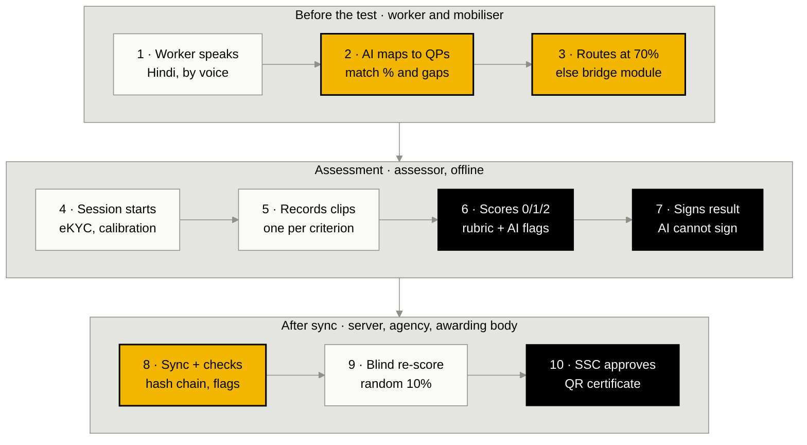
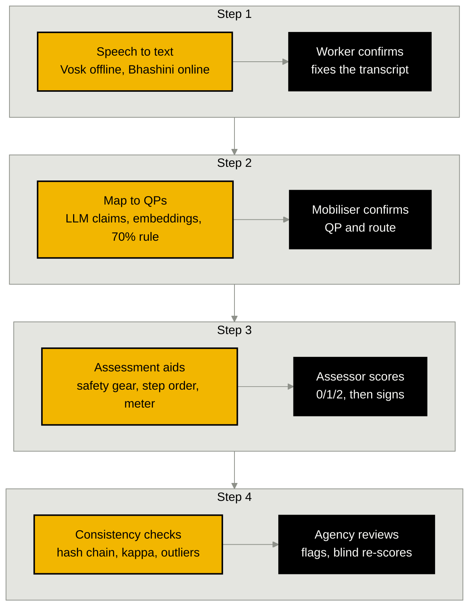
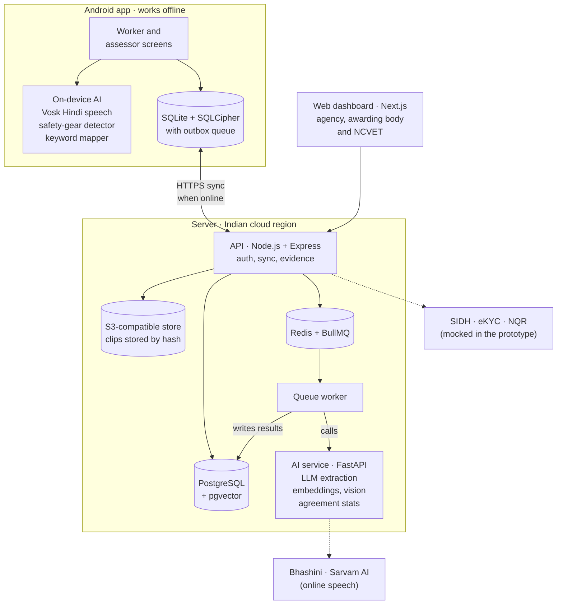
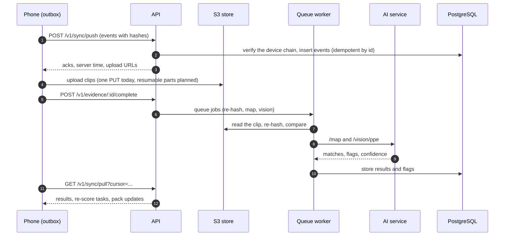
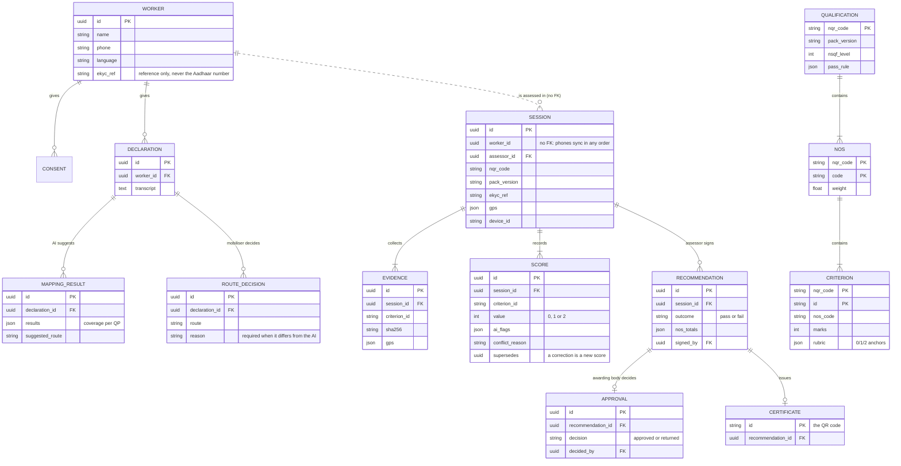
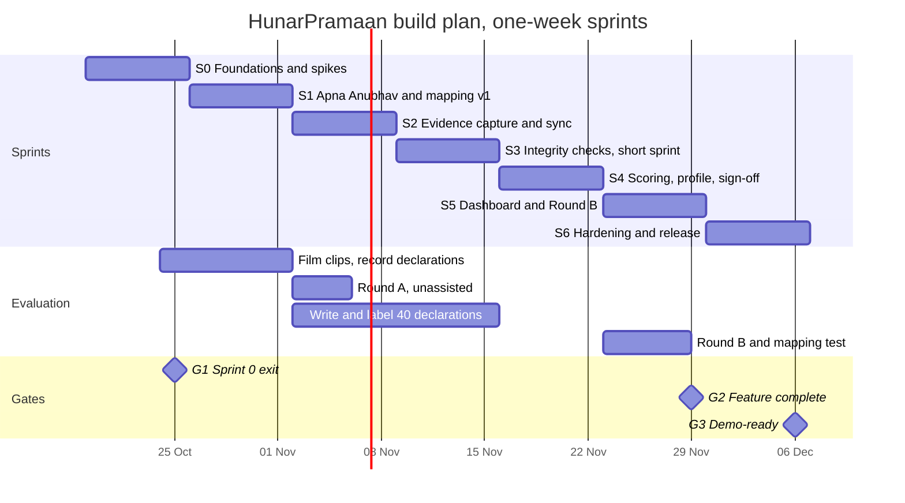

<div align="center">

# HunarPramaan · हुनर प्रमाण

**Your skill, certified, without going back to class.**

An offline-first, AI-assisted assessment tool for Recognition of Prior Learning (RPL), built for Smart India Hackathon 2026.

[](https://www.sih.gov.in/)


</div>

| Item | Detail |
|---|---|
| Problem statement | AI-Assisted Skill Assessment Tool for Recognition of Prior Learning (RPL) |
| PS ID · Theme | `[PS ID]` · `[Theme]` |
| Team | `[Team name]` · Team ID `[Team ID]` |
| Repository | [github.com/Sameergit23/Hunarparmaan](https://github.com/Sameergit23/Hunarparmaan) |
| Pilot qualification | [Assistant Electrician](https://www.nqr.gov.in/qualifications/13772), CSDCI, NSQF Level 3 · `QG-03-CO-03951-2025-V2-CSDCI` |
| Also mapped to | [Construction Electrician-LV](https://www.nqr.gov.in/qualification/file/QF_Construction%20Electrician%20-%20LV_v%205.0_L%204_English.pdf), CSDCI, NSQF Level 4 · `QG-04-CO-03952-2025-V2-CSDCI` |
| Platforms | Android app for workers and assessors (works offline) · web dashboard for agencies, awarding bodies and NCVET |
| Languages | Hindi and English, by voice or text |

> [!NOTE]
> **Status: Sprint 0 (19–25 Oct 2026).** The API, the web dashboard and the shared packages run on your own computer, with tests; see [Getting started](#getting-started). The mobile app, the AI service and the admin panel ([design](docs/design/access-control.md)) come next. We wrote this README first, so it is the contract we build to. Commands marked *planned* start working as the sprints land.

**Contents:** [Why](#why-this-exists) · [What it does](#what-it-does) · [How it works](#how-it-works) · [AI vs assessor](#ai-supports-the-assessor-decides) · [AI workflow](#ai-workflow) · [UI design](#ui-design) · [Architecture](#architecture) · [Stack](#tech-stack) · [Repo layout](#repository-layout) · [Getting started](#getting-started) · [Core logic](#core-logic) · [Data model](#data-model) · [API](#api-overview) · [Offline, integrity, privacy](#offline-integrity-and-privacy) · [**SDLC plan**](#development-lifecycle-sdlc) · [Testing](#testing-and-evaluation) · [Deployment](#deployment-and-release) · [Maintenance](#maintenance) · [Team](#team) · [Contributing](#contributing) · [References](#references)

---

## Why this exists

Most skilled workers in India learned on the job and have no certificate to show for it. NCVET's [RPL guidelines](https://www.psscive.ac.in/storage/uploads/documents/1709540278_Guidelines%20for%20Recognition%20of%20Prior%20Learning%20(RPL).pdf) let them be certified against NSQF levels without repeating training. Assessment is still manual, though: slow to scale, inconsistent between assessors, and hard to schedule for daily-wage workers.

- Only **4.4%** of youth aged 15–29 have formal vocational training, and another 16.6% learned informally (PLFS 2022-23, in the [Economic Survey 2023-24, ch. 8](https://indiabudget.gov.in/budget2024-25/economicsurvey/doc/eschapter/echap08.pdf)).
- **31.89 crore** unorganised workers had registered on e-Shram by 18 Aug 2026 ([PIB](https://static.pib.gov.in/WriteReadData/specificdocs/documents/2026/aug/doc_9692_20260825_14270901.pdf)).
- PMKVY's RPL component had certified **57.34 lakh** workers by 31 Dec 2025, which is under 2% of e-Shram's registrations ([Lok Sabha Starred Q 138](https://eparlib.sansad.in/bitstream/123456789/3021530/1/AS138_pU6aaw.pdf)).
- The CAG's 2025 audit of PMKVY found no policy for keeping photo or video proof of training, and weak identity controls ([CAG Report No. 20 of 2025](https://cag.gov.in/uploads/PressRelease/PR-Press-Brief-Report-No-20-of-2025-English-06944f390e59d02-19424340.pdf)).

## What it does

Five modules cover the PS for one trade, from self-declaration to a signed recommendation.

| Module | What it does | PS outcome it answers |
|---|---|---|
| **M1 · Apna Anubhav** | Runs a guided voice interview in Hindi or English, maps the answers to QPs, and shows the match %, the gaps and the route | Self-declaration mapped to QPs; a QP mapping engine |
| **M2 · Task kit and evidence** | Gives a task checklist per NOS and captures one 30–60 s clip per criterion, stamped with time, GPS and device, and SHA-256 hashed at capture | Guided checklists with video aids |
| **M3 · Standard scoring** | Uses anchored 0/1/2 rubrics and calibration on 3 reference clips; AI flags are shown as suggestions only | Standard rubrics and less assessor variance |
| **M4 · Profile and recommendation** | Builds a NOS-wise competency profile and checks the pass mark; the assessor signs and the awarding body approves; SIDH export (mocked) | Competency profile and recommendation for sign-off |
| **M5 · Monitoring dashboard** | Shows agreement metrics and outlier assessors, sends a random 10% of clips for blind re-scoring, and verifies the hash chain | Evidence of consistency improvement |

Everything on the phone works with no network and syncs later.

## How it works



Yellow steps are AI or automated. Black steps are decisions a person makes. AI never scores, signs or approves.

## AI supports, the assessor decides

The PS asks where the tool supports assessor judgement and where it would replace it. Our line is that the tool never replaces it:

| Decision | What AI does | Who decides | Safeguard |
|---|---|---|---|
| Which qualification to assess against | Suggests QPs with match % and gaps | Mobiliser and worker confirm or change it | Low-confidence matches go to human review; mapping is never counted as evidence |
| Direct assessment or bridge module first | Applies the 70% rule to the coverage score | Mobiliser, who can override with a reason | Overrides are logged and visible to the agency |
| Score for each performance criterion | Shows flags: missing safety gear, wrong step order, meter reading | Assessor gives the 0/1/2 score | AI cannot enter or change a score; a conflict needs a one-line reason |
| Pass or fail against the QP | Totals NOS-wise marks and checks the QP's pass mark | Assessor reviews the profile | Only an assessor account can sign |
| Certification recommendation | Drafts the recommendation and gap list | Assessor signs; the awarding body approves | A random 10% plus flagged cases are re-scored blind by a master assessor |
| Evidence authenticity | Checks the hash chain, timestamps and location | Agency investigates flagged sessions | Broken or missing evidence blocks the recommendation |

## AI workflow

The AI does four jobs in a row. After each job, a person checks the result before the next one starts.



Yellow boxes are AI steps, which only suggest. Black boxes are the people who check and decide.

| AI job | On the phone, offline | On the server or online |
|---|---|---|
| Speech to text | Vosk small Hindi model | Bhashini (Sarvam AI as backup), used when there is signal |
| Mapping to QPs | Glossary + keyword match (BM25): an instant, provisional result | LLM claim extraction + multilingual-e5 embeddings: the final result |
| Assessment aids | Safety-gear detector on frames from each clip | Vision-language model: step order, meter readings, the finished-work photo |
| Consistency checks | SHA-256 hash of each clip at capture | Hash-chain check, reused-clip detection, kappa/alpha per assessor, 10% blind re-score sample |

**Guardrails**

- **The LLM only extracts; it never scores.** Every claim must quote the worker's own words, and the server checks that the quote really appears in the transcript. Invented experience is dropped.
- **Failures fall back safely.** If the LLM call fails or returns invalid JSON, it retries once. After that, the keyword result stands and the case goes to the mobiliser.
- **Low confidence goes to a person.** Every AI output shows its reason and a confidence score. A person reviews when, for example, coverage falls between 65% and 75%, or the server's result changes the phone's provisional route.
- **Only people decide.** Mapping never counts as evidence; only the practical test does. The API's role checks stop any AI job from writing a score or signing.
- **Only transcripts go to outside AI services.** Names, phone numbers and eKYC references never leave our servers.

**How it improves.** Every human correction is logged: transcript edits, QP overrides, and flags the assessor disagreed with. The AI/ML lead uses the log to grow the glossary, re-tune the match threshold and retrain the safety-gear detector. Three numbers show whether it is working: the transcript-correction rate, the mapping-override rate and the share of false flags.

## UI design

The screens use **Wire code**: the wiring colours Indian electricians already know, each with one job on screen. The rules are in [`docs/design/wire-code.md`](docs/design/wire-code.md), the values in [`tokens.json`](docs/design/tokens.json), and HTML references for five screens in [`docs/design/screens/`](docs/design/screens/).

| Colour | Hex | Means |
|---|---|---|
| Yellow, a phase colour | `#F2B600` | An AI hint, which only suggests |
| Black, the neutral colour | `#000000` | A person's action or decision: buttons, selections, scores, signatures |
| Green, the earth colour | `#2E7D32` | Done, verified, passed or synced |
| Red, a phase colour | `#C8102E` | Errors and the recording dot |
| Blue, a phase colour | `#1F4E9C` | The brand stripe, and nothing else |

The split between yellow and black puts [our decision table](#ai-supports-the-assessor-decides) on every screen: the AI's hint sits beside the person's choice and never takes its place. Headings use Rajdhani and text uses Hind; both cover Devanagari. Worker screens are Hindi first, with audio, picture choices and 54px buttons, so they work without reading (NFR-06).

## Architecture

The phone does everything offline, and one link syncs it with the server when there is signal. The API and its queue worker are the only components that write to the database.



1. **Input:** the worker's voice answers, the assessor's scores and clips, and QP files from NQR.
2. **On the phone:** speech-to-text, fallback mapping, evidence hashing and local scoring, all offline.
3. **On the server after sync:** LLM task extraction, embedding match, vision checks and agreement statistics.
4. **Output:** match % and route, a NOS-wise competency profile, a signed recommendation and dashboard metrics.

<details>
<summary><b>Sync, step by step</b></summary>



</details>

## Tech stack

| Layer | Choice | Why |
|---|---|---|
| Mobile app | React Native (Expo **dev build**) + TypeScript | One codebase for low-end Android, and the team's core skill. It needs a dev build, not Expo Go, because Vosk and SQLCipher are native modules |
| On-device data | `expo-sqlite` with SQLCipher, Drizzle ORM, and an outbox table for sync | Encrypted and local-first: every write lands on the phone first |
| Offline speech | [Vosk small Hindi model](https://alphacephei.com/vosk/models) (`vosk-model-small-hi-0.22`, 42 MB, Apache-2.0) via [react-native-vosk](https://github.com/riderodd/react-native-vosk) | Runs without internet. Word error rate is about 21–25%, so the worker confirms the transcript |
| Online speech and language | [Bhashini](https://bhashini.gov.in/) (MeitY), with [Sarvam AI](https://docs.sarvam.ai/api-reference) as backup | Better accuracy when online; Bhashini is the government's own language stack |
| Vision on the phone | A small safety-gear detector (TFLite or ONNX, chosen in the Sprint 0 spike) | Flags missing gloves or a missing helmet offline |
| API | Node.js + Express (TypeScript), zod, JWT with role-based access | Our core stack |
| Jobs | Redis + BullMQ | Keeps heavy AI off the API and retries failed jobs |
| AI service | Python 3.12 + FastAPI | Handles LLM claim extraction (any OpenAI-compatible endpoint), [multilingual-e5-small](https://huggingface.co/intfloat/multilingual-e5-small) embeddings (MIT, 384 dimensions), vision checks, and statsmodels + krippendorff for agreement |
| Database | PostgreSQL 17 + pgvector | Stores QP data and scores as relational data, with vector search in the same database |
| Media | S3-compatible storage: SeaweedFS (Apache-2.0) for development | Clips are stored under their hash. Production can use any S3 store |
| Dashboard | Next.js + Tailwind + Recharts | Quick to build; server rendering suits slow networks |
| Hosting | Docker on an Indian cloud region; MeghRaj/NIC cloud in production | Data stays in India |

> [!IMPORTANT]
> **Two changes from the idea PPT.**
>
> - MinIO's community repository was [archived on 25 Apr 2026](https://github.com/minio/minio) and no longer gets updates, so we use SeaweedFS behind the same S3 API.
> - We use `expo-sqlite`, which has [SQLCipher built in](https://docs.expo.dev/versions/latest/sdk/sqlite/), instead of WatermelonDB.

## Repository layout

Folders marked *planned* do not exist yet; they arrive in the sprints named in the [sprint plan](#sprint-plan).

```text
Hunarparmaan/
├── CLAUDE.md                  # rules and context for Claude Code
├── apps/
│   ├── web/                   # Next.js: public site, certificate check, dashboard for agencies, awarding bodies, NCVET
│   │   ├── src/app/           # pages: landing, login, verify, and the signed-in (office) screens
│   │   ├── src/components/    # Wire code components
│   │   ├── src/lib/           # API client, session, i18n (en.ts, hi.ts), flag and blocker wording
│   │   └── e2e/               # Playwright tests
│   └── mobile/                # planned: React Native worker and assessor app, works offline
├── services/
│   ├── api/                   # Node.js + Express: auth, sync, evidence; the only database writer
│   │   ├── src/routes/        # HTTP only
│   │   ├── src/domain/        # rules and queries: sync, projections, results, recommendations
│   │   ├── src/db/            # Drizzle schema, migrate, seed, PGlite lock
│   │   ├── src/worker/        # BullMQ worker: re-hashes clips (AI jobs come with services/ai)
│   │   ├── migrations/        # SQL migrations, including the append-only triggers
│   │   ├── scripts/           # reset-local-db.ts (pnpm db:reset)
│   │   └── test/              # integration tests, IT-01 to IT-03
│   └── ai/                    # planned: Python FastAPI, claim extraction, embeddings, vision, agreement stats
├── packages/
│   ├── contracts/             # zod schemas shared by phone, API and web; AUTHORITY and READ_ACCESS tables
│   ├── scoring/               # pure TypeScript: coverage, routing, results (same code on phone and server)
│   ├── audit/                 # hash chain: canonical JSON (RFC 8785), SHA-256, verify
│   └── trade-packs/           # QP data per trade: NOS, criteria, marks, rubrics, glossary
├── evaluation/                # planned: rater study and mapping test
├── infra/
│   ├── docker-compose.yml     # PostgreSQL + pgvector, Redis, SeaweedFS
│   └── postgres-init/         # creates the hp_test database
├── docs/
│   ├── problem-statement.md   # the official SIH PS text
│   ├── design/                # Wire code, tokens, screen references, data model, access control
│   └── adr/                   # architecture decision records 001 to 011
└── .github/
    ├── workflows/ci.yml
    └── pull_request_template.md
```

## Getting started

Everything runs on your own computer, on Windows, macOS or Linux. You only need Git and Node.js. Docker is optional.

### Prerequisites

| Tool | Version | Used for |
|---|---|---|
| Git | Any recent version | Cloning the repo |
| Node.js | 22.18 or later, or 24.11 or later. Node 25 and later are not supported yet | API, dashboard, tests |
| pnpm | 10, the version pinned in `package.json` | Workspaces |
| Docker Desktop, or Docker Engine with Compose v2 | Latest stable | Optional: PostgreSQL, Redis and the S3 store, as in production |
| Python + [uv](https://docs.astral.sh/uv/) | 3.12 | AI service (*planned*) |
| Android Studio + JDK 17 | Latest stable | The Android dev build (*planned*) |
| An Android phone | Android 9+, 3 GB RAM | The target device (*planned*): test on it, not only on the emulator |

### 1. Install Node.js and pnpm (once per computer)

| OS | Node.js 24 |
|---|---|
| Windows | The Node.js 24 installer from [nodejs.org](https://nodejs.org/en/download), or `fnm install 24` with [fnm](https://github.com/Schniz/fnm) |
| macOS | `brew install node@24`, or `nvm install 24` with [nvm](https://github.com/nvm-sh/nvm) |
| Linux | `nvm install 24` with [nvm](https://github.com/nvm-sh/nvm), or your distribution's Node.js 24 package |

`.nvmrc` names Node 24, so `nvm use` or `fnm use` in the repo picks it. Then turn on pnpm. Corepack ships with Node 22 and 24 and picks the pnpm version pinned in `package.json`:

```bash
corepack enable
node -v    # v22.18 or later, or v24.11 or later
pnpm -v    # 10.28.0
```

On Windows, `corepack enable` fails with `EPERM` in a normal terminal. Run it once in an administrator terminal, or install pnpm directly with `npm install -g pnpm@10.28.0`.

### 2. Clone and run, no Docker

```bash
git clone https://github.com/Sameergit23/Hunarparmaan.git
cd Hunarparmaan
pnpm install
pnpm db:seed      # trade pack, demo accounts and a demo pilot (8 sessions)
pnpm dev          # API on :4000, web on :3000; Ctrl+C stops both
```

The same commands work in PowerShell, Command Prompt, Git Bash and macOS or Linux terminals. You need no `.env` file. With no settings, the API:

- runs [PGlite](https://pglite.dev), a real PostgreSQL inside Node, with its data in `services/api/.data/pglite`;
- keeps clips in `services/api/.data/objects`;
- runs background jobs in its own process, without Redis;
- signs logins with a development-only key. It does this only in development with `PUBLIC_API_URL` on localhost; set `JWT_SECRET` as soon as you change `PUBLIC_API_URL` to a LAN address for a phone.

Open `http://localhost:3000` and sign in with a demo account. The one-time code is shown on screen (OTP is mocked) and the PIN is `1234`.

Every account belongs to one organisation ([ADR 010](docs/adr/010-organisations-admin-roles-access-control.md)). The seed has six: HunarPramaan (the operator), CSDCI (the awarding body, which owns both electrician QPs), two assessment agencies (Indore Assessment Agency and Bhopal Skills Assessment), Indore RPL Centre (a training partner) and NCVET.

| Demo account | Organisation | Mobile number | Sees |
|---|---|---|---|
| Assessment agency | Indore Assessment Agency | `9000000006` | Dashboard, sessions, flags |
| Awarding body | CSDCI | `9000000007` | Dashboard, approvals, sessions |
| NCVET | NCVET | `9000000008` | Dashboard (aggregates only) |
| Mobiliser | Indore RPL Centre | `9000000001` | Phone role: the API accepts it, and the web sign-in sends it to the phone app |
| Assessors Anil and Rekha · Vikram | Indore Assessment Agency · Bhopal Skills Assessment | `9000000002`, `9000000003` · `9000000004` | Phone roles |
| Master assessor | CSDCI | `9000000005` | Phone role |
| Second agency's user | Bhopal Skills Assessment | `9000000020` | Dashboard, sessions, flags |
| Platform admins | HunarPramaan | `9000000009`, `9000000014` | Invite staff through the API (`POST /v1/admin/invites`); admin screens come in Sprints 3 and 4 |
| Training-partner admins | Indore RPL Centre | `9000000010`, `9000000015` | The same |
| Agency admins | Indore Assessment Agency · Bhopal Skills Assessment | `9000000011`, `9000000016` · `9000000018`, `9000000019` | The same |
| Awarding-body admins | CSDCI | `9000000012`, `9000000017` | The same |
| A pending agency invite | Indore Assessment Agency | `9000000013` | Not an account yet: on the sign-in page, open "Have an invite code? Set up your account", then use the SMS code, the invite code `24681357` (demo mode only) and a new 6-digit PIN |

The names, numbers and study figures in the demo are made up; the study rounds are marked as demo numbers.

### 3. Check your setup

```bash
pnpm check        # lint, typecheck and test, the same checks as CI
```

Run it before every push. The first run takes about a minute, because the API tests build a migrated database once and cache it in `node_modules/.cache`. CI runs them on Linux (Node 22 and 24) and Windows (Node 24), and also runs `pnpm build`, the API tests on PostgreSQL, the browser tests, a secret scan (gitleaks) and `pnpm audit --audit-level high`; the sections below show how to run those locally. In VS Code, accept the recommended extensions (ESLint, Prettier, EditorConfig, Tailwind, Vitest, Playwright) so problems show while you type.

### End-to-end tests in a browser

The Playwright tests sign in and approve a real recommendation, so start them on fresh demo data; on a second run, the 2 approval tests are skipped.

```bash
pnpm e2e:install                 # once: downloads Chromium for Playwright
pnpm db:reset && pnpm db:seed    # fresh demo data (stop pnpm dev first)
pnpm dev                         # terminal 1
pnpm e2e:web                     # terminal 2
```

On Linux, Chromium may also need system libraries: `pnpm --filter @hunarpramaan/web exec playwright install-deps chromium`. If you already have Chromium, set `PLAYWRIGHT_CHROMIUM_PATH` to it instead of running `pnpm e2e:install`.

### Full setup, with Docker

This runs the same services as production: PostgreSQL 17 with pgvector, Redis for the job queue and SeaweedFS as the S3 store.

1. Copy the settings file and turn on the Docker block: `cp .env.example .env` (Command Prompt: `copy .env.example .env`), then uncomment the lines under "the Docker setup" in `.env`.
2. Start the services and wait until they are healthy:

   ```bash
   docker compose -f infra/docker-compose.yml up -d --wait
   ```

3. Create the tables and load the demo, then start the apps:

   ```bash
   pnpm db:migrate
   pnpm db:seed
   pnpm dev
   ```

4. In a second terminal, start the queue worker (it needs `REDIS_URL`): `pnpm --filter @hunarpramaan/api dev:worker`.

`docker compose -f infra/docker-compose.yml down` stops the services, and `down -v` also deletes their data. If PostgreSQL, Redis or another program already uses port 5432, 6379 or 8333 on your computer, stop it, or move the Docker port: for example `HP_POSTGRES_PORT=5433` before `docker compose` (PowerShell: `$env:HP_POSTGRES_PORT=5433`), with `localhost:5433` in `DATABASE_URL`. `HP_REDIS_PORT` and `HP_S3_PORT` work the same way.

**API tests on PostgreSQL.** The Docker setup also creates an empty `hp_test` database when it first creates its data volume. With a volume from before, create it once: `docker compose -f infra/docker-compose.yml exec postgres createdb -U hp hp_test`. The tests delete everything in it, and refuse any database without "test" in its name.

```bash
# macOS, Linux, Git Bash
TEST_DATABASE_URL=postgres://hp:hp@localhost:5432/hp_test pnpm --filter @hunarpramaan/api test
# PowerShell
$env:TEST_DATABASE_URL='postgres://hp:hp@localhost:5432/hp_test'; pnpm --filter @hunarpramaan/api test
```

**Secret scan and audit, as CI runs them.** With [gitleaks](https://github.com/gitleaks/gitleaks) installed: `gitleaks git .`. Then `pnpm audit --audit-level high`.

**Planned: the AI service and the Android dev build.** These folders do not exist yet. When they land: `cd services/ai`, `uv sync`, `uv run uvicorn app.main:app --reload --port 8000`; and `pnpm --filter @hunarpramaan/mobile android` (which runs `npx expo run:android`). The phone has to reach the API, so set `EXPO_PUBLIC_API_URL` to your computer's LAN address (for example `http://192.168.1.20:4000`), not `localhost`.

| Local service | Address |
|---|---|
| API | `http://localhost:4000` (OpenAPI docs at `/docs` are *planned*) |
| Web dashboard | `http://localhost:3000` |
| AI service | `http://localhost:8000` (*planned*) |
| PostgreSQL | `localhost:5432` (Docker setup) |
| Redis | `localhost:6379` (Docker setup) |
| S3 store (SeaweedFS) | `http://localhost:8333` (Docker setup) |

### Configuration

Settings are environment variables. Each app reads its own `.env` file, and none is needed for the quick start.

| App | Reads | When a setting is in more than one place |
|---|---|---|
| API (`services/api`) | The repo root `.env` and `services/api/.env` | Your shell wins, then `services/api/.env`, then the root `.env` |
| Web (`apps/web`) | `apps/web/.env` or `apps/web/.env.local` (Next.js) | Your shell wins. It does not read the root `.env` |

A setting typed in the shell, such as `PORT=4001 pnpm dev`, reaches the apps too: `turbo.json` passes the API and web settings through.

`.env.example` lists every variable with a comment. The main ones:

| Variable | Example | Used by |
|---|---|---|
| `DATABASE_URL` | `postgres://hp:hp@localhost:5432/hunarpramaan`; default `pglite:./.data/pglite` | api |
| `REDIS_URL` | `redis://localhost:6379`; without it, jobs run in the API process | api |
| `S3_ENDPOINT` · `S3_BUCKET` · `S3_ACCESS_KEY` · `S3_SECRET_KEY` | `http://localhost:8333` · `evidence` · …; without them, clips go to `LOCAL_OBJECT_DIR` | api |
| `JWT_SECRET` | A random string of 32 or more characters. Optional only in development with `PUBLIC_API_URL` on localhost | api |
| `PORT` | `4000` | api |
| `MOCK_INTEGRATIONS` | `true` (SIDH, eKYC, OTP, NQR); on by default outside production | api |
| `SIGN_IN_LIMITS` | `true`: limits on sign-in codes and the lockout after 5 wrong PINs. On by default except in development, so demos and Playwright can sign the same accounts in again and again | api |
| `PUBLIC_API_URL` | `http://localhost:4000`: where phones upload clips when there is no S3 store | api |
| `PUBLIC_WEB_URL` | `http://localhost:3000`: the QR target on certificates (*planned*, S4) | api |
| `RESCORE_SAMPLE_RATE` · `GEOFENCE_RADIUS_M` · `CLOCK_DRIFT_LIMIT_S` · `JWT_TTL_HOURS` | `0.10` · `200` · `300` · `12` | api |
| `TEST_DATABASE_URL` | `postgres://hp:hp@localhost:5432/hp_test`: API tests on PostgreSQL; the name must contain "test" | api tests |
| `API_URL` | `http://localhost:4000` (the default) | web |
| `AI_SERVICE_URL` | `http://localhost:8000` | api worker (*planned*) |
| `LLM_BASE_URL` · `LLM_API_KEY` · `LLM_MODEL` | Any OpenAI-compatible endpoint, preferably hosted in India | ai (*planned*) |
| `BHASHINI_USER_ID` · `BHASHINI_API_KEY` · `SARVAM_API_KEY` | From the Bhashini portal; Sarvam is the backup | ai (*planned*) |
| `EXPO_PUBLIC_API_URL` | `http://192.168.1.20:4000` | mobile (*planned*) |

To make a `JWT_SECRET` on any OS: `node -e "console.log(require('node:crypto').randomBytes(48).toString('base64'))"`.

> [!CAUTION]
> Never commit `.env`, API keys, real worker recordings, names, phone numbers or Aadhaar data. Use the seeded fixtures. `.gitignore` already leaves out `.env` files, media and `services/api/.data/`, and CI scans every PR for secrets.

### Useful scripts

Run them from the repo root.

| Command | What it does | Works now |
|---|---|---|
| `pnpm dev` | API and web in watch mode | ✅ |
| `pnpm check` | Lint, typecheck and test: run it before every push | ✅ |
| `pnpm db:seed` | Load the trade pack, demo accounts and demo pilot; running it again adds nothing | ✅ |
| `pnpm db:reset` | Delete the local PGlite database and clips, to start the demo again (stop `pnpm dev` first) | ✅ |
| `pnpm db:migrate` | Apply database migrations (the API also does this itself on PGlite) | ✅ |
| `pnpm --filter @hunarpramaan/api admin:bootstrap -- --name "<name>" --phone <number> --reason bootstrap` | Invite the first platform admin of a new installation and print the invite code once; refuses if one exists, unless `--additional` is passed (stop `pnpm dev` first on PGlite) | ✅ |
| `pnpm test` | Unit and integration tests in every workspace | ✅ TypeScript; Python with the AI service |
| `pnpm lint` · `pnpm typecheck` · `pnpm build` | ESLint and Prettier, TypeScript, production builds | ✅ |
| `pnpm format` | Rewrite files in Prettier style | ✅ |
| `pnpm pack:build electrician` | Validate and package a trade pack for phones | ✅ |
| `pnpm e2e:install` · `pnpm e2e:web` | Download Chromium once · run the Playwright flows (needs `pnpm dev` and fresh demo data) | ✅ |
| `pnpm --filter @hunarpramaan/<pkg> test` | Tests for one workspace only | ✅ |
| `pnpm e2e:mobile` | Maestro end-to-end flows on the phone | planned |
| `pnpm eval:study` · `pnpm eval:mapping` | Rater-study and mapping-test analysis | planned |

### Troubleshooting

| Problem | What to do |
|---|---|
| `The local database .data/pglite is open in another process` | Only one process can open the local database. Stop `pnpm dev` with Ctrl+C, then run the command again. If nothing is running, delete the `.lock` file the message names |
| Every demo sign-in fails | The database has no demo data yet: run `pnpm db:seed` |
| Odd database errors, or you want the demo from the start | Stop `pnpm dev`, then run `pnpm db:reset && pnpm db:seed`. With Docker, run `docker compose -f infra/docker-compose.yml down -v`, start it again, then `pnpm db:migrate && pnpm db:seed` |
| Port 3000 or 4000 is already in use | Stop the other program. To find it, run `netstat -ano \| findstr :4000` and then `taskkill /PID <pid> /F` on Windows, or `lsof -i :4000` on macOS and Linux. Or move the API: put `PORT=4001` and `PUBLIC_API_URL=http://localhost:4001` in `services/api/.env`, and `API_URL=http://localhost:4001` in `apps/web/.env` |
| `pnpm lint` reports every file on Windows | The files were checked out with CRLF line endings. The repo's `.gitattributes` keeps LF; a clone made before it existed needs a fresh clone, or (after committing your work) `git rm -r --cached -q . && git reset --hard` |
| `corepack enable` fails with `EPERM` | Run it in an administrator terminal, or `npm install -g pnpm@10.28.0` |
| `corepack: command not found`, or `pnpm install` warns about your Node version | Use Node 22.18+ or 24.11+; Node 25 and later ship without Corepack |
| `pnpm e2e:web` says Chromium's executable doesn't exist | Run `pnpm e2e:install` once |
| `pnpm e2e:web` skips 2 tests | An earlier run approved the demo's clean recommendation. Stop `pnpm dev`, run `pnpm db:reset && pnpm db:seed`, and start again |
| The sign-in page says the server cannot be reached | The web app cannot reach the API. The `pnpm dev` terminal prints the address it tried: check that the API started and that `API_URL` in `apps/web/.env` matches its port |
| `API_URL` or `PORT` is ignored | Put API settings in the root `.env` or `services/api/.env`, and `API_URL` in `apps/web/.env`; the web app never reads the root `.env` |
| `pnpm build` fails with a font download error | The web build downloads the Rajdhani and Hind fonts from Google Fonts, so it needs internet. `pnpm dev` falls back to system fonts when offline |
| `&&` is an error in PowerShell | Windows PowerShell 5.1 has no `&&`. Run the commands one at a time, or use PowerShell 7 or Command Prompt |

## Core logic

### Mapping a declaration to a QP

1. **Interview.** The app asks guided voice questions per NOS, such as "Kya aapne earthing ka kaam kiya hai? Kaise karte hain?". Follow-up questions go only to NOS not yet covered, so the interview stays short.
2. **Extract.** An LLM turns the transcript into structured claims: task, tools, materials, setting, years and frequency. The output must pass a JSON schema, and a criterion with no claim gets no credit. For example, *"15 saal se ghar ki wiring karta hoon, MCB lagata hoon, earthing bhi deta hoon"* becomes:

   ```json
   [
     {"task": "house wiring", "years": 15, "quote": "ghar ki wiring karta hoon"},
     {"task": "install MCB", "quote": "MCB lagata hoon"},
     {"task": "earthing", "quote": "earthing bhi deta hoon"}
   ]
   ```

3. **Match.** Each claim is embedded and compared with every criterion by meaning. Glossary hits such as "earthing dena" or "MCB lagana" raise the score. A criterion counts as covered above a similarity threshold, which we tune on the labelled set.
4. **Score and route.** Coverage is weighted by each NOS's share of the QP and each criterion's marks:

   ```math
   \text{coverage}(Q) = \sum_{n \in Q} w_n \cdot \frac{\sum_{c \in n,\ c\ \text{covered}} m_c}{\sum_{c \in n} m_c}
   ```

   Here $w_n$ is the NOS's weight in the QP (the weights sum to 1) and $m_c$ is the marks for criterion $c$. At **coverage ≥ 0.70** the worker books a direct assessment. Below that, the app suggests a bridge module for the gap NOS and explains why, for example "Matched 14 of 19 criteria; gaps: measuring earth resistance, inspecting temporary distribution boards". Short or unclear answers go to the mobiliser for review.

5. **Offline fallback.** With no signal, the phone matches glossary terms and keywords (BM25) against the trade pack and gives a provisional result. The full engine re-scores after sync.

### Turning scores into a result

The same weighting turns the assessor's 0/1/2 scores $s_c$ into the QP result. So one function in `packages/scoring` does both jobs, on the phone and on the server:

```math
\text{result}(Q) = \sum_{n \in Q} w_n \cdot \frac{\sum_{c \in n} m_c \cdot s_c / 2}{\sum_{c \in n} m_c}
```

The worker passes when the result meets the QP's pass rule, which is copied from the QP file into the trade pack. Giving half marks for a score of 1 is our design choice; we will confirm it with the domain mentor.

### Trade pack

Each trade has one versioned pack that carries everything the phone needs offline: about 70 MB including the models. Codes and texts come from the QP files on NQR. The schema is `TradePack` in [`packages/contracts`](packages/contracts/src/trade-pack.ts), and the draft electrician pack is in [`packages/trade-packs/packs/electrician`](packages/trade-packs/packs/electrician). The values below are only illustrative.

```json
{
  "schemaVersion": "1.0",
  "pack": { "id": "csdci-electrician", "version": "2026.11.0", "status": "released", "languages": ["hi", "en"] },
  "policy": { "routingThreshold": 0.7, "reviewBand": { "low": 0.65, "high": 0.75 } },
  "qualifications": [
    {
      "nqrCode": "QG-03-CO-03951-2025-V2-CSDCI",
      "title": { "en": "Assistant Electrician", "hi": "सहायक इलेक्ट्रीशियन" },
      "nsqfLevel": 3,
      "awardingBody": "CSDCI",
      "passRule": { "aggregatePercent": 70 },
      "nos": [
        {
          "code": "<NOS code from the QP file>",
          "title": { "en": "<NOS title>", "hi": "<Hindi title>" },
          "weight": 0.3,
          "criteria": [
            {
              "id": "<NOS code>.PC4",
              "text": { "en": "Measure earth resistance and leakage", "hi": "<Hindi text>" },
              "marks": 10,
              "glossary": ["earthing dena", "earth pit", "megger"],
              "rubric": {
                "0": { "en": "Cannot use the tester or misreads it", "hi": "<Hindi>" },
                "1": { "en": "Takes a reading but skips a safety step or cannot say if the value is acceptable", "hi": "<Hindi>" },
                "2": { "en": "Takes a correct reading safely and judges it against the limit", "hi": "<Hindi>" }
              },
              "evidence": { "type": "video", "minSeconds": 30, "maxSeconds": 60 },
              "aiChecks": ["ppe.gloves", "meter.reading"]
            }
          ]
        }
      ]
    }
  ],
  "calibrationClips": [
    { "id": "calib-01", "nqrCode": "QG-03-CO-03951-2025-V2-CSDCI", "criterionId": "<NOS code>.PC4", "masterScore": 1, "sha256": "<hash of the clip file>" }
  ],
  "models": { "asr": "vosk-model-small-hi-0.22", "ppe": "ppe-detector-v1" }
}
```

The schema also checks that:

- NOS weights in each QP sum to 1;
- criterion ids are unique within a QP (PC numbers restart in each NOS, so ids carry the NOS code);
- every title, criterion and rubric anchor has Hindi and English text;
- each calibration clip points at a real criterion.

A `released` pack also needs real NOS codes and at least 3 calibration clips; `pnpm pack:build` refuses it otherwise.

## Data model

The core entities are below. The full schema has 27 tables, adding accounts, devices, calibration, evidence checks, flags and re-scoring; [`docs/design/data-model.md`](docs/design/data-model.md) describes every one. Scores, evidence and audit entries are append-only, enforced by a database trigger. Each session stores the trade-pack version it used, so results stay valid after a QP is revised.



Every event a phone sends is stored as an `AUDIT_ENTRY` in that device's hash chain (`device_id`, `seq`, `type`, `actor`, `prev_hash`, `hash`), and the API projects it into the tables above. Decisions made on the web, such as approvals, flag reviews and route overrides, are written by the API as rows in the same append-only tables. Flags carry a code plus values (`flags.params`), which the web app words in Hindi and English.

## API overview

<details>
<summary><b>Main endpoints (v1)</b></summary>

Callers are checked against `AUTHORITY` (actions) and `READ_ACCESS` (reads) in `packages/contracts/src/authority.ts`.

| Method | Path | Who calls it | What it does |
|---|---|---|---|
| GET | `/healthz` | Anyone | Liveness check (CI and Docker use it) |
| POST | `/v1/auth/otp` | Anyone | Sends a sign-in code (mocked). Limits: 30 s between codes, 3 per number in 15 min, 10 a day, and a cap per IP address |
| POST | `/v1/auth/otp/verify` | Anyone with a code | Checks the code alone and returns a 10-minute ticket, plus whether the number has an account |
| POST | `/v1/auth/login` | Anyone with an account | Code + PIN (web) or ticket + PIN (phone); returns a JWT and the time of the sign-in before. 5 wrong PINs lock the account for 15 min, doubling up to an hour |
| POST | `/v1/auth/register` | A worker, with a ticket | Signs a worker up on their own phone, claiming the record a mobiliser made for the same number ([ADR 012](docs/adr/012-voice-sign-in.md), proposed) |
| POST | `/v1/auth/pin` · `/v1/auth/pin/reset` | Signed in · a worker with a ticket | Changes the PIN, or resets a forgotten worker PIN; older sign-ins and renewal keys end |
| POST | `/v1/admin/invites` | Admins, for the roles `GRANTABLE_ROLES` gives them | Invites a staff member into the admin's organisation (the platform admin names one) for a role its kind may hold: returns an 8-digit invite code once, valid 72 hours, and records it in the hash-chained admin log |
| POST | `/v1/auth/invite/accept` | An invited person, with a ticket | Creates the account from the invite code and a new PIN (5 tries) |
| POST | `/v1/auth/renewal-key` · `/v1/auth/refresh` | Phone roles, on their registered phone | Keeps a phone signed in: a 30-day key that renews the JWT and is replaced at each use |
| POST | `/v1/devices` | Mobiliser, assessor, master assessor | Registers a phone and binds it to the account |
| GET | `/v1/trade-packs/:id` | Every signed-in role | Downloads a versioned trade pack |
| POST | `/v1/sync/push` | Phone roles: worker, mobiliser, assessor, master assessor | Uploads a batch of events (idempotent by event id); returns acks, server time and upload URLs |
| GET | `/v1/sync/pull?cursor=` | Phone roles | New trade packs, the server's checks of your clips, and (master assessors) re-score tasks |
| PUT | `/v1/evidence/:id/content` | Assessor, master assessor | Uploads a clip through the API when there is no S3 store; a file that does not match its hash is refused |
| POST | `/v1/evidence/:id/complete` | Assessor, master assessor | Confirms a clip upload and queues the server re-hash (vision jobs come with the AI service) |
| POST | `/v1/declarations/:id/override` | Mobiliser | Changes the route or QP online, with a reason |
| GET | `/v1/sessions` · `/v1/sessions/:id` | Agency, awarding body | Sessions with evidence checks, scores, flags and the recommendation |
| POST | `/v1/sessions/:id/sign` | Assessor, master assessor | Signs the recommendation online; refused if the result does not match the scores |
| GET | `/v1/recommendations` | Agency, awarding body | Signed recommendations waiting for a decision, with what blocks them |
| POST | `/v1/recommendations/:id/approve` | Awarding body | Approves (and issues the certificate) or returns the recommendation |
| GET | `/v1/audit/sessions/:id/verify` | Agency, awarding body | Verifies the hash chain |
| GET | `/v1/flags` · POST `/v1/flags/:id/review` | Agency | Integrity flags and the agency's review notes |
| GET | `/v1/dashboard/summary` | Agency, awarding body, NCVET | Key numbers |
| GET | `/v1/dashboard/agreement` | Agency, awarding body, NCVET | Agreement metrics and outlier assessors (NCVET gets no per-assessor rows) |
| GET · POST | `/v1/rescoring` | Master assessor | Blind re-score queue and submissions |
| GET | `/v1/certificates/:id/verify` | Public | Certificate status as JSON, for the web app's `/verify/:id` page that the QR code opens |
| GET | `/v1/public/study` | Public | Rater-study results for the website |
| POST | `/v1/exports/sidh` | Awarding body | Mock SIDH export |

The AI service (*planned*) is internal and only the queue worker will call it: `POST /extract`, `/embed`, `/map`, `/vision/ppe`, `/phash` and `/stats/agreement`.

</details>

**Roles and permissions.** The API checks the role in each JWT before every action, against the `AUTHORITY` and `READ_ACCESS` tables in [`packages/contracts/src/authority.ts`](packages/contracts/src/authority.ts). The full design, with what is built and what is planned, is in [docs/design/access-control.md](docs/design/access-control.md).

| Role | App | What the role can do | Status |
|---|---|---|---|
| Worker | Mobile, usually with a mobiliser | Give consent and a declaration; sign up on their own phone; later, see their own profile | API built; phone app and profile planned |
| Mobiliser | Mobile | Register workers; review mapping; override the route with a reason | API built; phone app planned |
| Assessor | Mobile | Calibrate, capture evidence, score and sign | API built; phone app planned |
| Master assessor | Mobile | Re-score a sampled clip blind, for the awarding body | API built; phone app planned |
| Agency | Web | Monitor sessions and assessors; investigate flags; see agreement and outlier assessors | Built |
| Awarding body (SSC) | Web | Approve recommendations and issue certificates | Built |
| NCVET | Web | See aggregates only | Built |
| Platform admin | Web admin | Create and suspend organisations; invite each one's first admin; upload trade packs | Role and actions in contracts; accounts in S1, screens in S3–S4 |
| Agency, training-partner and awarding-body admins | Web admin | Invite, deactivate and unlock their own staff; revoke lost phones; the awarding-body admin also releases trade packs and accredits assessors | Roles and actions in contracts; accounts in S1, screens in S3–S5 |

**Admins never decide.** Admin roles manage people, organisations and phones. They never score, sign, approve, review a flag or edit a record, and nobody who decides can administer ([ADR 010](docs/adr/010-organisations-admin-roles-access-control.md)). Every account belongs to one organisation, and from Sprint 2 each sees only its own organisation's records. Personal data such as names and phone numbers moves out of the hash chain early in Sprint 1, so it can be erased without breaking the chain ([ADR 011](docs/adr/011-personal-data-outside-the-hash-chain.md)).

## Offline, integrity and privacy

**Offline by design**

- **Trade pack (about 70 MB):** criteria, rubrics, glossary, calibration clips, the Vosk Hindi model and the safety-gear model.
- **Local-first writes:** every write is saved on the phone first. The outbox retries with back-off, clips upload in resumable parts, and video can be set to upload on Wi-Fi only.
- **No merge conflicts:** scores, evidence and audit entries are append-only events with time-ordered UUIDv7 ids. QP data is owned and versioned by the server.
- **Light media:** clips are 480p and 30–60 s per criterion. The assessor always sees what is still waiting to sync.

**Evidence integrity**

- **Hash chain:** each file gets a SHA-256 hash at capture, with time, GPS and device ID. It goes into a hash-chained log in which every entry includes the previous entry's hash, computed over canonical JSON (RFC 8785).
  - There is one chain per device, so offline phones never need to coordinate.
  - The server verifies the chain on every sync.
- **Login and identity:** the assessor app is bound to a registered device, with OTP + PIN login. Each session starts with an identity check (eKYC, mocked) and a start photo.
- **Automatic flags:** sessions are flagged when they happen outside the venue's geofence, use a mocked GPS location, or show device time far from server time.
- **Reused clips** are caught by an exact hash match or by near-identical frames (perceptual hash).
- **Blocking:** broken or missing evidence blocks the recommendation.

**Privacy (DPDP)**

- **DPDP Rules 2025:** [notified on 13 Nov 2025](https://www.hlc.com/en/publications/indias-digital-personal-data-protection-act-2023-brought-into-force-). Their notice, consent and security duties apply from 13 May 2027, and we build to them now.
- **Consent:** before any recording, the worker hears a standalone consent notice in their language. Withdrawing consent is as easy as giving it.
- **Encryption:** no Aadhaar number is stored, only the eKYC reference. Data is encrypted on the device (SQLCipher), in transit (TLS) and at rest.
- **Access by role:** each role sees only what it needs, and NCVET only aggregates. Scoping by organisation (an agency sees only its own sessions) lands in Sprint 2; today every agency and awarding-body account sees every session.
- **Logs:** request logs redact tokens and cookies and never include request bodies, so no phone number, OTP or PIN reaches them (`services/api/src/logger.ts`).
- **Training data and retention:** faces are blurred in any clip used to improve the models, and data is deleted when the audit period ends.
- **Breaches** are reported to the Data Protection Board without delay, with the follow-up report within 72 hours.
- **Hosting:** everything is hosted in India.

---

## Development lifecycle (SDLC)

We follow the classic SDLC phases but run them **iteratively, in one-week sprints**. Every "define" step is paired with a "verify" step, as in the **V-model**.

**Why this model**

- **Not waterfall:** our biggest risks (native modules on a 3 GB phone, Hindi speech accuracy, finding raters) only show up once we build. Mentor and judge feedback will also change the requirements.
- **Not full Scrum:** six students with classes and exams need light ceremonies, not a heavy process.
- **V-model testing:** an assessment tool has to show that every PS outcome is met and checked. So each requirement gets its test when it is written.

### Phases, outputs and gates

| Phase | When | What we do | Output in the repo | Gate |
|---|---|---|---|---|
| 1 · Planning | Done (Oct) | Chose the PS; wrote the solution design, idea PPT, roles and first risk list | This README, `docs/` | **G0** Idea submitted |
| 2 · Requirements | Sprint 0, refined every sprint | Interview an ITI instructor, a certified assessor, 2–3 electricians and an RPL centre; write user stories for the 6 roles; set NFRs; prioritise with MoSCoW | `docs/requirements/` (SRS, stories, traceability), GitHub issues | **G1** |
| 3 · Design | Sprints 0–1, then just in time | Architecture, data model, API contract, trade-pack schema, sync protocol, rubric anchors, wireframes, threat model | `docs/design/`, `docs/adr/`, `packages/contracts` | **G1** |
| 4 · Implementation | Sprints 0–5 | One vertical slice per module, walking skeleton first | `apps/`, `services/`, `packages/` | **G1**, **G2** |
| 5 · Testing | Every sprint, plus Sprint 6 | Unit → integration → airplane-mode E2E → usability → rater study and mapping test | Tests, `evaluation/`, test reports | Part of every gate |
| 6 · Deployment | Sprint 6 | Staging server, laptop demo-in-a-box, release APK, `v1.0.0` | `infra/`, release notes | **G3** |
| 7 · Maintenance | Finale and after | Fixes only after the freeze. After SIH: pilots, new trade packs, model monitoring | `CHANGELOG.md`, issues | — |

| Gate | Date | Passed when |
|---|---|---|
| **G0** Idea submitted | SPOC deadline | Idea PPT uploaded |
| **G1** Sprint 0 exit | 25 Oct | The mentor agrees the requirements baseline. Contracts v1 are frozen: trade-pack schema, sync events and core API. The walking skeleton runs on the real phone |
| **G2** Feature complete | 29 Nov | Every Must-have story meets the Definition of Done, and the study numbers are on the dashboard |
| **G3** Demo-ready | 6 Dec | The airplane-mode drill passes 3 times in a row, `v1.0.0` is tagged and the backup video is recorded |

### Sprint plan



| Sprint | Dates | Goal | Done when (shown at the review, on the real phone) |
|---|---|---|---|
| S0 | 19–25 Oct | Foundations and spikes | A declaration recorded offline appears on the dashboard after sync (walking skeleton) |
| S1 | 26 Oct–1 Nov | M1 Apna Anubhav + mapping engine v1 | Speak Hindi offline → transcript → match % for L3 and L4 → route with reasons |
| S2 | 2–8 Nov | M2 evidence capture + sync queue | The assessor records clips offline and sync uploads them; an edited clip is rejected. Round A data is collected |
| S3 | 9–15 Nov (short) | Integrity checks and catch-up | Geofence, clock and reuse flags work; device binding and login work; Round A is analysed |
| S4 | 16–22 Nov | M3 scoring + M4 profile and sign-off | The full offline flow runs from declaration to a signed recommendation |
| S5 | 23–29 Nov | M5 dashboard + Round B + mapping test | **G2:** kappa for Round A vs Round B and the mapping accuracy are on the dashboard |
| S6 | 30 Nov–6 Dec | Hardening and release | **G3:** the drill passes 3 times, `v1.0.0` is tagged and the backup video is recorded |

> [!NOTE]
>
> - **Diwali:** it falls on Sunday 8 Nov, so the S2 review moves to Thursday 5 Nov and S3 is a short sprint.
> - **Finale date:** SIH 2026 notices so far say only "December" for the Grand Finale. If the SPOC announces a date before 7 Dec, shorten S6.

<details>
<summary><b>Who does what, sprint by sprint</b></summary>

| Sprint | Lead + mobile | Backend | AI/ML | Web | Domain + data | Design + pitch |
|---|---|---|---|---|---|---|
| S0 | Spike: one Expo dev build with Vosk, camera and SQLCipher on the 3 GB phone; outbox table | Monorepo, CI, Docker Compose; Express + JWT roles; 10-table schema; `/sync/push` stub | Test Vosk on 20 real Hindi recordings; embed criteria with e5; FastAPI skeleton | Next.js skeleton, login, sessions list | Turn the QP files (L3, L4) into a criteria sheet; glossary v0; confirm the ITI mentor; recruit 3+ electricians | Wireframes of both flows; paper test with 2 workers |
| S1 | Interview screens with audio prompts; confirm or correct the transcript; offline result | Trade-pack API (versioned); declarations; route override with a reason | LLM claim extraction (JSON schema); e5 + glossary match; keyword pack for the phone; `packages/scoring` | Trade-pack viewer; mobiliser review queue | Rubric anchors for 4 criteria with the instructor; film 12 study + 3 calibration clips; master scores; record 20 declarations | High-fidelity screens; Hindi copy and audio prompts |
| S2 | Task kit; one clip per criterion (480p); SHA-256, time, GPS; hash chain; sync queue with resumable uploads | Sync push and pull (idempotent); pre-signed uploads; chain check on sync | Safety-gear detector spike | Session detail: evidence player, chain status | **Round A** (unassisted, 7 raters); write 20 Hinglish declarations | Usability test of M1 with 5 workers (SUS) |
| S3 | Device binding, OTP + PIN, eKYC mock, start photo, geofence | Flags: geofence, clock drift, exact-hash reuse; audit verify endpoint | Perceptual-hash reuse check; stats service; Round A analysis | Flags list | Label the 40 declarations with the instructor | Pitch storyline v1 |
| S4 | Calibration flow; rubric scoring with AI flags and the reason prompt; profile; sign | Recommendation, approval, QR verify page, mock SIDH export | Safety-gear flag in scoring, with confidence | Profile and approval screens | UAT script with the mentor; Round B logistics | Usability test of the assessor flow (3 assessors) |
| S5 | Polish, error states, low-memory handling | Blind re-score sampling (10% + flagged), master queue | Round B and mapping-test analysis (full engine and fallback) | Agreement dashboard (kappa with CI), outliers, re-score queue | **Round B**, calibration first (crossover if raters allow) | Demo script v1; backup-video storyboard |
| S6 | Release APK; airplane-mode drills | Demo-in-a-box on the laptop; k6 sync test | Tune thresholds; freeze models | Live results screen | Domain Q&A preparation | Record the backup video; rehearse |

</details>

### V-model: every "define" has a "verify"

| Define (left side) | Verify (right side) | Signed off by |
|---|---|---|
| Requirements: user stories and NFRs | Acceptance tests, UAT with the domain mentor, rater study and mapping test | Mentor + domain lead |
| System design: architecture and sync protocol | System tests: airplane-mode E2E drills, sync load test | Team lead |
| Module design: API contract and trade-pack schema | Integration and contract tests | Module owner |
| Code | Unit tests | PR reviewer |

### Requirements baseline v1

<details>
<summary><b>Functional requirements</b></summary>

| ID | Requirement | Module | Priority |
|---|---|---|---|
| FR-01 | The worker gives a self-declaration by voice in Hindi or English, with no network | M1 | Must |
| FR-02 | The worker sees and hears the transcript and can confirm or correct it | M1 | Must |
| FR-03 | The system maps the declaration to the L3 and L4 QPs and shows match %, covered criteria and gaps | M1 | Must |
| FR-04 | Coverage ≥ 70% routes to direct assessment, and anything lower to a bridge module. The mobiliser can override with a logged reason | M1 | Must |
| FR-05 | The assessor logs in on a registered device (OTP + PIN) and opens a session with an identity check (eKYC mocked) and a start photo | M2 | Must |
| FR-06 | The app guides one 30–60 s clip per criterion at 480p, stamped with time, GPS and device ID and hashed at capture into the audit chain | M2 | Must |
| FR-07 | Before scoring, the assessor scores 3 reference clips and sees where they differ from the master scores | M3 | Must |
| FR-08 | The assessor scores each criterion 0/1/2 against anchored rubrics. AI flags (including missing safety gear) appear with their confidence, and a score that conflicts with a flag needs a one-line reason | M3 | Must |
| FR-09 | The app totals NOS-wise marks, checks the QP pass rule, and drafts the profile and recommendation. Only an assessor account can sign | M4 | Must |
| FR-10 | Every write is saved on the phone first and synced later, with retries and resumable uploads; the pending count is always visible | All | Must |
| FR-11 | The server verifies the hash chain on every sync and flags geofence breaches, clock drift and exact-hash clip reuse | M5 | Must |
| FR-12 | The dashboard shows sessions, profiles, agreement metrics and outlier assessors | M5 | Must |
| FR-13 | A random 10% of clips, plus every flagged case, goes to a master assessor for blind re-scoring | M5 | Must |
| FR-14 | The dashboard shows the rater-study results and the mapping accuracy | M5 | Must |
| FR-15 | Perceptual-hash detection of near-identical reused clips | M5 | Should |
| FR-16 | Meter-reading capture and the step-order check | M3 | Should |
| FR-17 | Awarding-body approval, a QR-verifiable certificate preview and a mock SIDH export | M4 | Should |
| FR-18 | A second regional language through Bhashini | M1 | Could |
| — | Real Aadhaar eKYC and SIDH integration, trades beyond electrician, iOS | — | Won't (this round) |

</details>

<details>
<summary><b>Non-functional requirements</b></summary>

| ID | Quality | Target |
|---|---|---|
| NFR-01 | Offline | 100% of worker and assessor steps work with no network |
| NFR-02 | Devices | Android 9+ with 3 GB RAM; trade pack about 70 MB |
| NFR-03 | Sync | A completed session syncs within 2 minutes on 4G |
| NFR-04 | Security | SQLCipher on the phone, TLS in transit, encryption at rest, least-privilege roles; scores, evidence and audit entries are append-only |
| NFR-05 | Privacy | DPDP-style consent notice in the worker's language, read aloud; no Aadhaar numbers stored; hosting in India |
| NFR-06 | Usability | Worker screens usable without reading (icons + audio); SUS score of 68 or more |
| NFR-07 | Explainability | Every AI output shows its reason and confidence; people can override it, and overrides are logged |
| NFR-08 | Mapping quality | Top-1 QP accuracy ≥ 80%; routing agreement with the instructor ≥ 85% |
| NFR-09 | Languages | Every screen in Hindi and English |

</details>

**Traceability: PS outcome → requirement → proof**

| PS expected outcome | Requirements | Verified by |
|---|---|---|
| A working workflow from self-declaration to an assessor-facing scoring interface, for at least one trade | FR-01 to FR-10 | E2E-01 and the demo |
| An NSQF qualification-pack mapping engine | FR-03, FR-04, NFR-08 | Mapping test |
| Evidence of consistency improvement over unassisted manual scoring | FR-07, FR-08, FR-13, FR-14 | Rater study, Round A vs Round B |
| An offline-capable mobile/web interface | FR-10, NFR-01, NFR-03 | E2E-02, E2E-03 |
| A clear line between where the tool supports and where it would replace assessor judgement | FR-08, FR-09, NFR-07 | IT-03 and the [decision table](#ai-supports-the-assessor-decides) |

### Ways of working

| When | What | Time box |
|---|---|---|
| Monday | Sprint planning: pick stories from the backlog, highest priority first | 45 min |
| Every day | Stand-up (call or voice notes): done, next, blocked | 10 min |
| End of sprint | Review on the real phone (mentor invited), then a retro: keep, change, try | 60 min |

- **Roles:**
  - The domain and data lead is the product owner, with the mentor as the voice of assessors.
  - The team lead is the scrum master and tech lead.
  - Every module has an owner and a backup, so exams never block a module.
- **Board:** GitHub Projects, with columns Backlog → Ready → In progress → Review → Done. Each issue names its requirement ID, such as `FR-06`.

**Definition of Ready.** A story can enter a sprint when:

- it has acceptance criteria (Given / When / Then);
- it links a requirement ID;
- it has a mock-up or API contract where needed;
- its test data exists;
- it fits in one sprint.

**Definition of Done**

- [ ] Merged to `main` through a reviewed PR, with CI green (lint, types, tests)
- [ ] Acceptance criteria shown at the sprint review
- [ ] Works in airplane mode, if it runs on the phone
- [ ] Hindi and English strings added
- [ ] No secrets, Aadhaar numbers or real worker data in the code
- [ ] Docs or an ADR updated if a design decision changed

**Branches, commits and CI**

- **Branches:** `main` is protected and always demo-able. Work happens on short-lived branches such as `feat/m2-evidence-capture` or `fix/sync-retry`.
- **Commits:** [Conventional Commits](https://www.conventionalcommits.org/), for example `feat(mobile): record clip per criterion` or `fix(api): reject duplicate events`.
- **Pull requests:** one reviewer, green CI, and the Definition of Done ticked, then squash-merge.
- **Tags:** each sprint-review build is tagged (`v0.1.0` after S1 … `v1.0.0` for the demo). After a freeze, only `fix:` PRs approved by the lead get merged.
- **CI (GitHub Actions):**
  - On every PR: lint, type check, unit and integration tests (TypeScript and Python), a secret scan (gitleaks), a dependency audit and a web build.
  - On tags: Docker images and a release APK (EAS Build).

**Architecture decisions to record in Sprint 0** (`docs/adr/`)

1. A monorepo with pnpm workspaces and Turborepo
2. An Expo dev build instead of Expo Go, because of the native modules
3. `expo-sqlite` + SQLCipher + an outbox instead of WatermelonDB
4. Append-only events, with the API as the only database writer
5. SeaweedFS as the S3 store, because the MinIO community edition is archived
6. AI output is a suggestion: only assessors sign, and only awarding bodies approve
7. Detector licence: Ultralytics YOLO is AGPL-3.0. That is fine for the prototype, but swap to an Apache-2.0 detector such as YOLOX before any public release

### Risks

<details>
<summary><b>Risk register</b></summary>

| Risk | Likelihood | Impact | Mitigation | Owner |
|---|---|---|---|---|
| Vosk, camera, SQLCipher and the detector don't work together in one Expo build | Medium | High | Sprint 0 spike on the real phone. Fallback: run the safety-gear check on the server after sync | Lead |
| Speech recognition fails on dialect or site noise | High | Medium | The worker confirms the transcript; picture options; mobiliser-assisted mode; Bhashini when online | AI/ML |
| Not enough workers or raters for the clips and the study | Medium | High | Recruit in week 1 through ITIs, contractors and RPL centres. Fallback: instructor-performed clips | Domain |
| Mapping picks the wrong QP | Medium | Medium | Confidence threshold, human review and manual QP choice; mapping never counts as evidence | AI/ML |
| Vision flags are wrong in bad light | Medium | Medium | Flags only, with confidence; an on-screen framing guide | AI/ML |
| Venue Wi-Fi or a phone fails at the finale | High | High | Demo-in-a-box on a hotspot, a spare phone and a backup video | Backend |
| Scope creep | High | Medium | MoSCoW; feature freeze at G2 and at hour 30 of the finale | Lead |
| Exams and the festival week cut team time | Medium | Medium | Short sprint in S3; a backup owner for every module | Lead |
| An unmaintained or restrictive dependency | Low | Medium | SeaweedFS instead of the archived MinIO; the AGPL detector only in the prototype | Backend, AI/ML |
| Privacy of study participants | Low | High | Signed consent, blurred faces, no recordings in Git | Domain |

</details>

### The 36-hour finale

| Hours | Plan |
|---|---|
| 0–2 | Set up the demo-in-a-box, run the drill once, and re-plan with mentor feedback |
| 2–20 | Make judge and mentor changes as small PRs; keep `main` demo-able |
| 20 | First full rehearsal, then repeat every few hours |
| 30 | Feature freeze: fixes only |
| 30–34 | Fix bugs, rebuild the APK and refresh the backup video |
| 34–36 | Final rehearsal and rest |

Rotate sleep so that nobody codes exhausted.

---

## Testing and evaluation

### Test levels

| Level | Tools | What it covers | When it runs |
|---|---|---|---|
| Unit | Vitest; jest-expo and pytest *planned* | Coverage and result formulas; the routing edge case (0.699 vs 0.700); hash chain; rubric rules; kappa and alpha against a published worked example | Every PR |
| Contract | zod schemas (OpenAPI *planned*) | Phone ↔ API payloads; trade-pack schema | Every PR |
| Integration | Supertest on in-process PGlite, or PostgreSQL 17 with `TEST_DATABASE_URL` (CI); jobs run inline. FastAPI TestClient *planned* | Idempotent sync; chain verification; queue → AI → database; role checks | Every PR |
| End-to-end | Playwright (web); [Maestro](https://maestro.mobile.dev/) (Android) *planned* | The full flow; the airplane-mode drill; the dashboard updating after sync | Before every review |
| Performance | k6 and the Android Studio profiler on the 3 GB phone (*planned*) | 50 phones syncing at once; app memory; time to transcript | S5–S6 |
| Security | gitleaks, `pnpm audit`, tamper tests; pip-audit *planned* | Secrets; vulnerable packages; an edited clip rejected; the wrong role blocked | Every PR, and in S6 |
| Usability | SUS questionnaire, think-aloud sessions | 5 workers and 3 assessors | S2 and S4 |
| Acceptance | UAT with the mentor, evaluation studies | Whether the PS outcomes are met | S5–S6 |

**Must-pass scenarios**

- **E2E-01 Full flow:** declaration → evidence → scores → signature, all offline. After sync, the dashboard shows the session as verified.
- **E2E-02 Airplane mode:** every worker and assessor step works with no network.
- **E2E-03 Sync time:** a completed session syncs within 2 minutes on 4G.
- **E2E-04 Crash safety:** killing the app mid-recording loses no saved data.
- **IT-01 Idempotency:** pushing the same batch twice stores it once.
- **IT-02 Tampering:** a clip whose bytes don't match its captured hash is rejected and flagged. Editing one audit row makes verification fail at that row.
- **IT-03 Authority:**
  - only an assessor account can sign;
  - only an awarding-body account can approve;
  - no AI job can write a score.
- **IT-04 Admins never decide:** no admin token can score, sign, approve, review a flag or re-score. Both halves are built: the unit half in `packages/contracts/src/authority.test.ts`, and the API half in `services/api/test/invites.test.ts`, where every admin role gets 403 for every decision.
- **IT-05 Scoping** (*planned*, Sprint 2): an account outside the record's organisation gets "not found".
- **IT-06 Sign-in limits:** codes are limited per number and per IP address, and 5 wrong PINs lock the account for 15 minutes, doubling up to an hour (`services/api/test/signin.test.ts`).
- **IT-07 Renewal keys:** a phone's renewal key is replaced at each use; reusing an old one, a PIN change, a revoked phone or 30 days unused ends it (`services/api/test/pin-renewal.test.ts`).

### Evaluation: the evidence the PS asks for

**Rater study** (`evaluation/rater-study/`)

| Item | Detail |
|---|---|
| Clips | 12 clips of 30–60 s covering 4 criteria (wiring through conduit, earthing, installing a protective device, safety gear), done by 3 workers and filmed with consent. Include partial and wrong attempts, so every score level appears |
| Raters | 7: our 6 team members and our mentor. Add ITI electrician instructors or certified assessors if we can; students are a weak stand-in for real assessors |
| Master score | One experienced electrician or instructor scores every clip first, as the reference |
| Round A, unassisted (S2) | Each rater scores every clip 0/1/2 from the QP criterion text alone, working alone, as assessors do today |
| Round B, with HunarPramaan (S5) | Calibration on 3 other clips first, then the same 12 clips, reshuffled, with anchored rubrics and AI flags. If there are enough raters, half of them do Round B first, to check for a learning effect |
| What we report | Fleiss' kappa per round, read with the Landis and Koch bands; ordinal Krippendorff's alpha; exact agreement with the master score; a 95% CI from 1,000 bootstrap resamples of the clips |

Ratings go in one long-format CSV per round, for example `ratings_round_a.csv`:

```csv
rater_id,clip_id,criterion_id,score,seconds_taken
R1,C01,PC3,2,41
R1,C02,PC3,1,55
R2,C01,PC3,2,38
```

**Mapping test** (`evaluation/mapping-test/`)

- **Declarations:** 40 in total. 20 are recorded from real workers (with consent) and 20 we write in Hinglish from QP content, including weak answers and other trades, such as a plumber, that should match neither QP.
- **Labels:** the instructor marks the correct QP (Level 3, Level 4 or neither) and the criteria each answer covers.
- **Report:** top-1 and top-3 QP accuracy, precision and recall on covered criteria, and agreement with the instructor's routing at the 70% line. We report these for both the full engine and the offline fallback.

| Target | Value |
|---|---|
| Top-1 QP accuracy | ≥ 80% |
| Routing agreement with the instructor | ≥ 85% |
| Steps that work offline | 100% |
| Sync time per session | ≤ 2 min |
| Inter-assessor agreement | Round B above Round A, with the 95% CI. We report the result whatever it is |

## Deployment and release

| Environment | Where | What runs | Updated |
|---|---|---|---|
| Local | Each laptop: Windows, macOS or Linux | `pnpm dev` on PGlite, or Docker Compose for the full stack; the AI service when it exists | Continuously |
| Staging | One VM in an Indian cloud region | The same Compose file behind Caddy (HTTPS) | On every merge to `main` |
| Demo-in-a-box | The team laptop, 2 phones and 1 spare | The full stack on the laptop's hotspot, seeded demo data and the release APK | Frozen at `v1.0.0` |
| Production (after SIH) | MeghRaj / NIC cloud | Managed PostgreSQL, object storage, monitoring and backups | Through the release process |

**Release checklist for `v1.0.0`**

- [ ] Every Must-have story meets the Definition of Done
- [ ] The airplane-mode drill passes 3 times in a row on both phones
- [ ] Study results and mapping accuracy are on the dashboard
- [ ] The release APK is on 2 phones + 1 spare, and the previous APK is kept for rollback
- [ ] The demo database snapshot restores in under 2 minutes
- [ ] The laptop runs the whole stack with Wi-Fi off
- [ ] The backup demo video is recorded

## Maintenance

| Type | What it means for HunarPramaan |
|---|---|
| Corrective | Fix bugs found in drills and pilots, triaged from P0 (blocks the flow) to P3 (cosmetic) |
| Adaptive | QP revisions arrive as new trade-pack versions, and each session keeps the version it used. NCVET rule changes (70% routing, 10% re-scoring) are configuration, not code |
| Perfective | New trades are new trade packs, not new code. More languages come through Bhashini, and better models from assessor feedback |
| Preventive | Weekly dependency updates and security patches. Model monitoring: transcript-correction rate, mapping override rate, safety-flag false positives. Backup-restore drills. DPDP readiness before 13 May 2027 |

After SIH, the next steps are:

- a pilot with an RPL centre or assessment agency in Madhya Pradesh;
- real SIDH and eKYC integration;
- an open-weight LLM hosted in India;
- a second trade.

## Team

| Role | Name | Owns | Backup |
|---|---|---|---|
| Lead and mobile developer | `[name]` | React Native app, offline sync, architecture, final integration | Backend |
| Backend developer | `[name]` | API, auth and roles, schema, sync endpoints, hash chain, media | Lead |
| AI/ML engineer | `[name]` | Mapping engine, speech, safety-gear model, agreement statistics | Backend |
| Web developer | `[name]` | Dashboard, charts, re-scoring queue, profile views | Design |
| Domain and data lead | `[name]` | QP parsing, glossary, rubric anchors, filming, study and mapping test | AI/ML |
| Design and pitch lead | `[name]` | Low-literacy UX, PPT, demo script, backup video, Q&A rehearsal | Web |

Mentors: `[faculty mentor]` and `[ITI electrician instructor or certified assessor]`. An SIH team has 6 members from the same institute, including at least one woman.

## Contributing

1. Pick an issue in **Ready** on the board and assign it to yourself.
2. Update `main` (`git pull`) and create a branch from it: `feat/<module>-<short-name>`, `fix/<short-name>` or `docs/<short-name>`.
3. Write the test with the code, and keep the PR small. Commit messages follow Conventional Commits, for example `feat(web): show the blocker list`.
4. Run `pnpm check` before you push.
5. Open the PR with the template, get one review, and squash-merge when CI is green.

## References

**RPL, skilling and audit**

- [NCVET: Guidelines for Recognition of Prior Learning, 11 Aug 2023](https://www.psscive.ac.in/storage/uploads/documents/1709540278_Guidelines%20for%20Recognition%20of%20Prior%20Learning%20(RPL).pdf)
- [Lok Sabha Starred Question 138, MSDE, 9 Feb 2026](https://eparlib.sansad.in/bitstream/123456789/3021530/1/AS138_pU6aaw.pdf)
- [CAG Report No. 20 of 2025, performance audit of PMKVY (press brief)](https://cag.gov.in/uploads/PressRelease/PR-Press-Brief-Report-No-20-of-2025-English-06944f390e59d02-19424340.pdf)
- [Economic Survey 2023-24, chapter 8](https://indiabudget.gov.in/budget2024-25/economicsurvey/doc/eschapter/echap08.pdf)
- [PIB: five years of e-Shram, Aug 2026](https://static.pib.gov.in/WriteReadData/specificdocs/documents/2026/aug/doc_9692_20260825_14270901.pdf)
- [NQR: Assistant Electrician, CSDCI, NSQF Level 3](https://www.nqr.gov.in/qualifications/13772) · [Construction Electrician-LV, NSQF Level 4](https://www.nqr.gov.in/qualification/file/QF_Construction%20Electrician%20-%20LV_v%205.0_L%204_English.pdf)
- [VETASSESS: AI-enabled RPL pilot, Dec 2025](https://www.vetassess.com.au/news/new-pilot-leads-the-way-in-ai-enabled-recognition-of-prior-learning)

**Measurement**

- [Fleiss (1971), Measuring nominal scale agreement among many raters](https://doi.org/10.1037/h0031619)
- [Landis and Koch (1977), Biometrics 33(1)](https://pubmed.ncbi.nlm.nih.gov/843571/)
- [Reddy and Andrade (2010), A review of rubric use in higher education](https://doi.org/10.1080/02602930902862859)

**Technology and law**

- [Vosk speech models](https://alphacephei.com/vosk/models) · [react-native-vosk](https://github.com/riderodd/react-native-vosk) · [multilingual-e5-small](https://huggingface.co/intfloat/multilingual-e5-small)
- [Bhashini](https://bhashini.gov.in/) · [Sarvam AI API reference](https://docs.sarvam.ai/api-reference)
- [Expo SQLite (SQLCipher support)](https://docs.expo.dev/versions/latest/sdk/sqlite/) · [MinIO community repository notice](https://github.com/minio/minio)
- [Hogan Lovells: India's DPDP Act 2023 brought into force](https://www.hlc.com/en/publications/indias-digital-personal-data-protection-act-2023-brought-into-force-)
- [SIH 2026 notice (DTU, 28 Aug 2026): team rules and a December Grand Finale](https://www.dtu.ac.in/Web/upload/events/aug/file0807.pdf)

## Licence

Not chosen yet; we suggest Apache-2.0, added as a `LICENSE` file in Sprint 0. Third-party models keep their own licences: the Vosk Hindi model is Apache-2.0, multilingual-e5-small is MIT and Ultralytics YOLO is AGPL-3.0.
