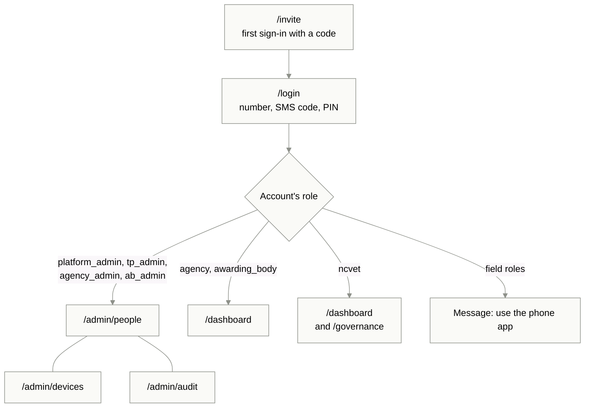
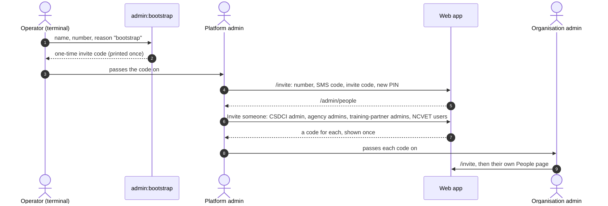
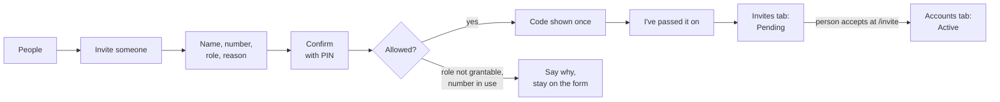
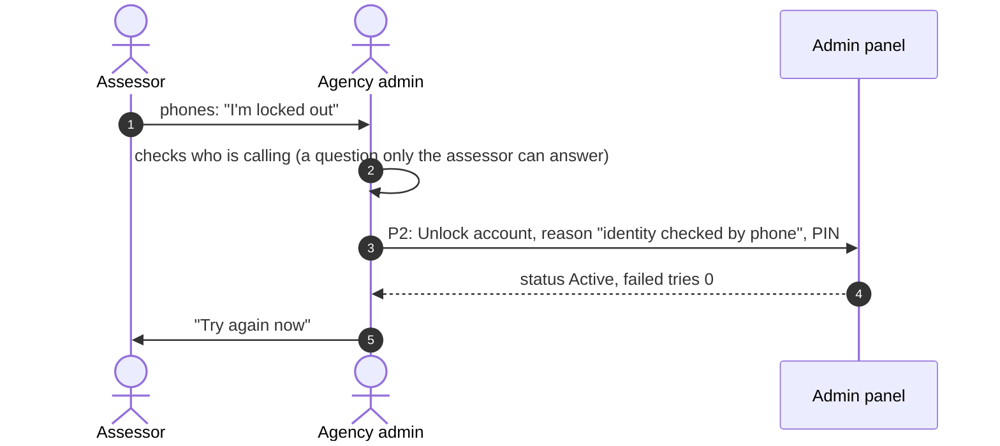
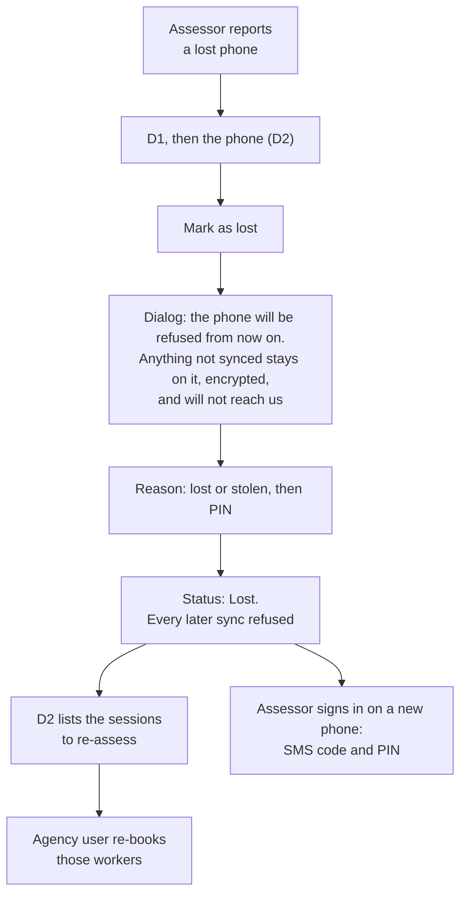
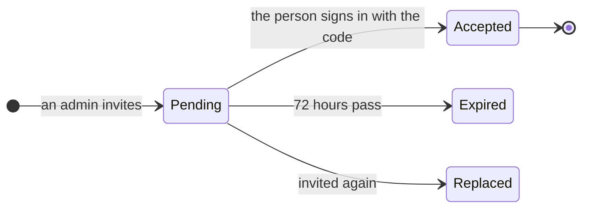
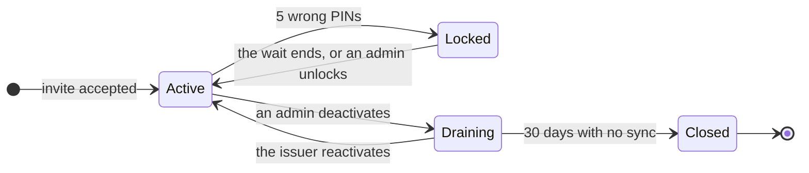
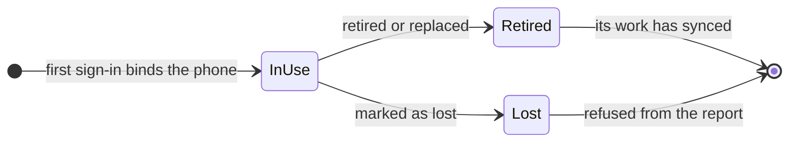

# Admin panel: app flow

- **Status:** Draft for team review, 18 Oct 2026
- **What it covers:** every admin screen, how people move between them, and what each button does
- **Related:** [PRD](prd.md), [TRD](trd.md), [requirements](requirements.md), [Wire code](../wire-code.md). The staff side of invites and sign-in is in `docs/design/workflows.md`, sections 3 and 4 (on the `docs/workflows-voice-sign-in` branch until it merges)

Phase 1 screens are built for G2. Phase 2 screens are marked as such.

## 1. Who goes where

- The role on the account decides where someone lands, never a button they tapped.
- Admin accounts never see the office dashboard, and office accounts never see `/admin`. A person who holds both jobs has two accounts (ADR 010: nobody who decides can administer).
- Typing an `/admin` address without an admin role shows "This page is not for your account" with a link home. The API would refuse the data anyway.

## 2. Navigation

| Role | Navigation | Lands on |
|---|---|---|
| `platform_admin` | People, Devices, Audit log. Phase 2: Organisations, Trade packs | People, filtered to organisation admins |
| `agency_admin` | People, Devices, Audit log | People |
| `tp_admin` | People, Devices, Audit log. Phase 2: Venues | People |
| `ab_admin` | People, Devices, Audit log. Phase 2: Accreditation, Trade packs | People |
| `ncvet` | Dashboard, Governance | Dashboard |

The header matches the office header: brand stripe, logo, navigation, name and role, "Last sign-in", the language switch, "Change PIN" and "Sign out". The organisation's name sits under the person's name, so an admin always knows whose data they are looking at.

## 3. Screens

### P1. People (`/admin/people`)

| Part | What it shows |
|---|---|
| Title | "People", with the organisation's name |
| Primary button | "Invite someone" |
| Tabs | "Accounts", and "Invites" with a count of pending invites |
| Filters | Role, status (Active, Locked, Draining, Closed), and search by name or the last 4 digits of the number |
| Account row | Name, masked number (`XXXXXX3210`), role, status chip, last sign-in, last sync. A count such as "3 waiting to sync" when the phone has unsynced items |
| Invite row | Name, masked number, role, invited by, expiry ("Expires in 2 days"), status chip (Pending, Accepted, Expired, Replaced) |
| Platform admin only | An organisation filter. Only admin and NCVET accounts can be acted on; the others are read-only rows |
| Empty state | "No one here yet. Invite your first staff member." |

Tapping a row opens P2.

### P2. Person (`/admin/people/[id]`)

| Part | What it shows |
|---|---|
| Heading | Name, role, status chip, organisation |
| Facts | Masked number, account created, invited by, last sign-in, last sync, failed PIN tries, "Locked until 10:45" when locked |
| Phones | Each phone bound to the account, with its status and last sync; each links to D2 |
| Recent admin actions | The last 20 admin-log entries about this account |
| Actions | Shown only when allowed, each opening the confirmation dialog (section 4): "Unlock account" (when locked), "Reset PIN", "Deactivate account" (when active), "Reactivate account" (when draining, and only for the person who deactivated it or the platform admin) |
| Not offered | On your own account: "You can't change your own account here. Use Change PIN, or ask another admin." |

### P3. Invite (`/admin/people/invite`)

| Step | What happens |
|---|---|
| 1. Form | Name, mobile number, role (only the roles this admin may grant), reason (New staff, Replacement, Another admin). The platform admin also picks the organisation |
| 2. Confirm | The dialog: "Invite Asha Verma as an assessor in Indore Assessment Agency?", with the PIN |
| 3. Code | The 8-digit code in large digits, "Valid for 72 hours, once", and how to pass it on: "Give this code to Asha in person or by phone. We never send it by SMS." The button "I've passed it on" closes it, and the code can't be shown again |
| 4. Back | The Invites tab, with the new invite as Pending |

To send a new code, invite the same number again. The new invite replaces the old one, and the old code stops working.

### D1. Devices (`/admin/devices`)

| Part | What it shows |
|---|---|
| Title | "Devices", with the organisation's name. Every device is a phone, so the rows and messages say "phone" |
| Filters | Status (In use, Retired, Replaced, Lost), and "Not synced for 3 days or more" |
| Row | Owner, phone label, status chip, registered on, last sync, clips waiting |
| Empty state | "No phones yet. A phone appears here when someone signs in on it for the first time." |

### D2. Phone (`/admin/devices/[id]`)

| Part | What it shows |
|---|---|
| Heading | Phone label, owner (links to P2), status chip |
| Facts | Registered on, last sync, events and clips waiting, as last reported |
| Actions | "Mark as lost" and "Retire this phone", both through the confirmation dialog |
| When lost | "Sessions to re-assess": each session started on this phone with no signed result, or with clips still waiting. The agency user opens them from the Sessions page |

### A1. Audit log (`/admin/audit`)

| Part | What it shows |
|---|---|
| Title | "Audit log" |
| Button | "Verify chain". The result appears beside it: "Verified: 214 entries, unbroken", or "The chain breaks at entry 87: an entry was changed or removed" |
| Filters | Action type and date range |
| Row | When, who acted, what they did ("Deactivated an account"), whom it concerned (links to P2 or D2), and the reason ("Left the organisation") |
| Scope | Own organisation. The platform admin sees every organisation |

### G1. Governance (`/governance`, NCVET)

Counts by organisation kind and action, per week, and the "Verify chain" result. No names or numbers. For example: "Assessment agencies: 12 invites, 2 deactivations, 1 phone lost this week."

## 4. The confirmation dialog

Every admin write goes through one dialog, so every action feels the same and none can be done by a slip.

| Part | Rule |
|---|---|
| Title | The action in plain words: "Deactivate Anil Sharma's account?" |
| Effect | What will happen, in one or two sentences (section 7) |
| Reason | A required list of reason codes for this action |
| PIN | The admin's own PIN, 6 digits |
| Buttons | Primary, black, naming the action ("Deactivate account"). Secondary: "Cancel". Never red |
| Errors | Inline, beside the field: "That PIN is not right." After 5 wrong PINs, the admin is locked like any account |
| Keyboard | Focus starts on the reason; Escape cancels; Enter submits only from the PIN field |

## 5. Flows

### F1. Day zero: setting up the pilot

For the demo, `pnpm db:seed` does all of this, and the organisations themselves are seeded (TRD section 10). Creating organisations on screen is phase 2.

### F2. Invite a staff member

| What can go wrong | What the admin sees |
|---|---|
| The role isn't theirs to grant | The role isn't in the list. If the API refuses anyway: "You can't invite someone with this role." |
| The number already has an account | "This number can't be invited. Ask the person to contact their current organisation." It never says which organisation |
| The invite expires | The row turns Expired. "Invite again" opens P3 with the details filled in |
| 30 invites in an hour | "Too many invites in an hour. Try again later." |

### F3. Someone leaves: deactivate

1. P1, the person's row, then P2.
2. "Deactivate account". The dialog says: "Anil won't be able to sign in or start new work. Anything already recorded on his phone will still sync, and it will be marked for review. 3 items are waiting to sync now."
3. Reason, PIN, "Deactivate account".
4. The status becomes Draining. Every sign-in Anil has ends at once.
5. When his phone next syncs, the work arrives with a "Synced after deactivation" flag for the agency to review. A session he started after the cut-off can't be approved.
6. After 30 days with no sync, or at once if he has no phone, the status becomes Closed.

| What can go wrong | What the admin sees |
|---|---|
| It's their own account | The button isn't there (P2) |
| He is the last active admin | "You can't deactivate the last admin. Invite another admin first." |

### F4. Bring someone back: reactivate

Only while the account is Draining, and only by the admin who deactivated it, or the platform admin. "Reactivate account", then reason and PIN. The person signs in again with the SMS code and their PIN. Anyone else sees: "Only the admin who deactivated this account, or the platform admin, can bring it back."

A Closed account can't come back. Invite the person again as a new account (one account, one role, for good).

### F5. Test-day lockout: unlock

Unlocking never shows or changes the PIN. If the assessor has forgotten it, use F6 instead.

### F6. Forgotten PIN: reset

1. P2, "Reset PIN", reason, the admin's PIN.
2. An 8-digit reset code, shown once, valid for 24 hours. Every sign-in the person has ends.
3. The person opens the app or `/login`, enters their number and the SMS code, then the reset code, then a new PIN twice.
4. The audit log records the reset. Nobody but the person ever knows the new PIN.

### F7. A phone is lost or stolen

The assessor's account stays active. Only the phone is cut off.

### F8. A new phone: retire the old one

When someone signs in on a new phone, the new phone is bound to their account. The admin then opens the old phone in D2 and chooses "Retire this phone", reason Replaced. The old phone drains: its unsynced work still arrives and is flagged for review, as in F3.

### F9. Check the record

1. A1, "Verify chain".
2. "Verified: 214 entries, unbroken." The admin can show this to an inspector.
3. If it fails: "The chain breaks at entry 87." The admin tells the platform admin, who reports it as a security incident (CERT-In asks for a report within 6 hours).

## 6. States

Chips follow Wire code: green fill for done or verified, black fill for in progress, a black outline for neutral.

| Status | Chip | Icon (lucide) |
|---|---|---|
| Active, In use, Accepted | Green fill, white text | `CircleCheck` |
| Pending invite | Black fill (in progress) | `MailPlus` |
| Draining | Black fill (in progress) | `Hourglass` |
| Locked | Black outline | `Lock` |
| Closed, Retired, Expired, Replaced | Black outline | `CircleSlash` |
| Lost | Black outline, red icon | `TriangleAlert` |

Lost uses red only on the icon, because it is an error state, and always with the word, as the session page already does for blockers.

## 7. Words on screen

Office and admin screens are English first. Every string also goes in `hi.ts`. A native speaker reviews the Hindi before G2.

| Key | English | हिंदी |
|---|---|---|
| Navigation | People, Devices, Audit log | लोग, डिवाइस, ऑडिट लॉग |
| Invite button | Invite someone | किसी को इनवाइट करें |
| Code shown | Give this code to {name} in person or by phone. We never send it by SMS. | यह कोड {name} को ख़ुद या फ़ोन पर बताएँ। हम इसे SMS से कभी नहीं भेजते। |
| Code passed on | I've passed it on | मैंने कोड बता दिया |
| Deactivate | Deactivate account | खाता बंद करें |
| Deactivate effect | {name} won't be able to sign in or start new work. Anything already recorded on their phone will still sync, and will be marked for review. | {name} साइन इन नहीं कर पाएँगे और नया काम शुरू नहीं कर पाएँगे। उनके फ़ोन में पहले से रिकॉर्ड किया गया काम सिंक होगा, और जाँच के लिए मार्क होगा। |
| Reactivate | Reactivate account | खाता फिर से चालू करें |
| Unlock | Unlock account | खाता अनलॉक करें |
| Reset PIN | Reset PIN | PIN रीसेट करें |
| Mark lost | Mark as lost | खोया हुआ बताएँ |
| Lost effect | This phone will be refused from now on. Anything it hasn't synced stays on it, encrypted, and won't reach us. | यह फ़ोन अब से नहीं लिया जाएगा। जो सिंक नहीं हुआ, वह फ़ोन में एन्क्रिप्टेड रहेगा और हम तक नहीं पहुँचेगा। |
| Retire | Retire this phone | यह फ़ोन हटाएँ |
| Reason | Reason | कारण |
| Your PIN | Your PIN | आपका PIN |
| Verify | Verify chain | चेन जाँचें |
| Verified | Verified: {n} entries, unbroken | जाँचा गया: {n} एंट्री, चेन पूरी है |
| Broken | The chain breaks at entry {seq}: an entry was changed or removed | एंट्री {seq} पर चेन टूटती है: कोई एंट्री बदली गई या हटाई गई |
| Last admin | You can't deactivate the last admin. Invite another admin first. | आख़िरी एडमिन का खाता बंद नहीं कर सकते। पहले किसी और को एडमिन इनवाइट करें। |
| Own account | You can't change your own account here. Use Change PIN, or ask another admin. | अपना खाता यहाँ नहीं बदल सकते। PIN बदलें इस्तेमाल करें, या किसी दूसरे एडमिन से कहें। |
| Number in use | This number can't be invited. Ask the person to contact their current organisation. | इस नंबर को इनवाइट नहीं कर सकते। उनसे अपने मौजूदा संगठन से बात करने को कहें। |
| Not your page | This page is not for your account. | यह पेज आपके खाते के लिए नहीं है। |
| Synced after deactivation (flag) | Synced after the account was deactivated | खाता बंद होने के बाद सिंक हुआ |

Statuses: Active (चालू), Pending (बाकी), Locked (लॉक), Draining (बंद हो रहा है), Closed (बंद), In use (इस्तेमाल में), Retired (हटाया गया), Lost (खो गया), Expired (समय ख़त्म), Replaced (बदला गया).

## 8. Phase 2 screens, in brief

| Screen | Who | Flow |
|---|---|---|
| Organisations | Platform admin | List with kind and status. "Add organisation": name in Hindi and English, kind, NCVET recognition number. "Suspend": reason and PIN; the organisation's accounts can't sign in until it's restored |
| Trade packs | Platform admin uploads; `ab_admin` releases | Upload a pack file, which is validated as `pnpm pack:build` does. A different person at the awarding body sees the changes and releases it. The uploader never sees "Release" |
| Accreditation | `ab_admin` | Each assessor, with the QPs they may assess and their SIDH assessor ID (a reference). "Grant" and "Revoke", with reason and PIN. Approval is blocked for a session by an assessor not accredited for its QP |
| Venues | `tp_admin` | Name, address, a point on a map and a geofence radius, at least 50 m |
| Settings | All admins | Read-only: effective values with their floors, such as "Re-score sample: 10% (it can't go lower)" |
