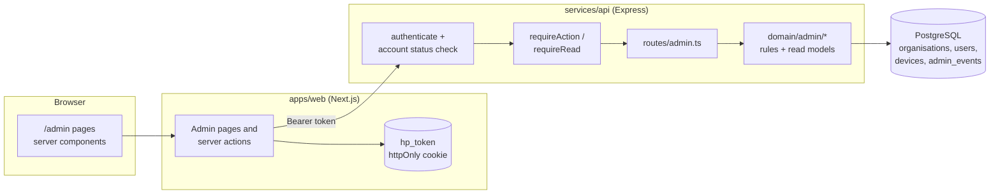

# Admin panel: technical requirements (TRD)

- **Status:** Draft for team review, 18 Oct 2026
- **Owner:** Backend lead, with the web developer
- **Product side:** [PRD](prd.md). Screens and flows: [app flow](app-flow.md). Requirement IDs: [requirements.md](requirements.md)
- **Builds on:** ADR 004 (append-only), ADR 006 (only people decide), ADR 008 (schema and tooling), ADR 009 (web app), ADR 010 (organisations and admin roles), ADR 011 (personal data)

Labels used below: **Built** is on `main`. **In review** is pushed on a branch but not merged. **To build** is new work.

## 1. Architecture

The admin panel is a part of the existing web app, not a new app. It follows the same path as every office screen: the browser talks to the Next.js server, which calls the API with the user's token. Only the API writes to the database (rule 3).

- **Same app, own area.** Admin pages live under `/admin` in `apps/web`, with their own shell and navigation. One sign-in page serves every web role and sends each to its home.
- **Same API, own router.** `services/api/src/routes/admin.ts` holds HTTP only. Rules and read models live in `services/api/src/domain/admin/`. Read models take no transaction (ADR 008).
- **Same authority tables.** Admin actions are already in `AUTHORITY` (`feat/contracts-admin-roles`). Admin reads get new `READ_ACCESS` scopes. Handlers never compare roles.
- **Same audit code.** The admin log is one hash chain sealed with `@hunarpramaan/audit`, like a phone's events (In review).

## 2. What exists today

| Piece | Where | Status |
|---|---|---|
| Admin roles, `OrgKind`, `ADMIN_ACTION_TYPES`, `ROLES_BY_ORG_KIND`, `GRANTABLE_ROLES`, `SCOPE_BY_ROLE`, `AdminErrorCode` | `packages/contracts` | In review (`feat/contracts-admin-roles`) |
| Unit tests: no admin holds a decision, no decider holds an admin action | `packages/contracts/src/authority.test.ts` | In review |
| `organisationId` in `SessionUser` and the JWT | contracts, `services/api/src/auth/tokens.ts` | In review |
| One pilot organisation for every account (`PILOT_ORGANISATION_ID`) | `services/api/src/domain/organisations.ts` | In review, to be replaced |
| Code-first sign-in, PIN rules, lockout, token version, renewal keys, `auth_events` | `services/api/src/domain/auth.ts`, migrations 0004 and 0005 | In review (`feat/api-auth-signin`) |
| `POST /v1/admin/invites`, `account_invites`, the hash-chained `admin_events`, demo admins | `services/api/src/domain/admin.ts`, migrations 0006 and 0007 | In review (`feat/api-staff-invites`) |
| `/invite` (accept an invite) and `/account/pin` (change PIN) | `apps/web/src/app` | In review (`feat/web-auth`) |
| Admin roles allowed into the web app | `OFFICE_ROLES` in `apps/web/src/lib/session.ts` | To build: admins are still refused |
| `devices.revoked_at` column | `services/api/src/db/schema.ts` | Built, but nothing sets it |
| Organisations, `qp_owners`, account status, device status, admin read models and screens | | To build |

## 3. Data model

New and changed tables. Organisations, users and devices are entities, so they stay mutable like `users` today; every change to them goes through an admin action, which is logged in the same transaction. `admin_events` and `auth_events` are append-only.

### 3.1 `organisations` (new)

| Column | Type | Notes |
|---|---|---|
| `id` | uuid PK | |
| `kind` | text | `operator`, `training_partner`, `assessment_agency`, `awarding_body` or `regulator` (`OrgKind`) |
| `name` | jsonb | `LocalizedText`, Hindi and English (rule 7) |
| `status` | text | `active` or `suspended` |
| `recognition_ref` | text, nullable | NCVET recognition number, for agencies and awarding bodies. A reference only |
| `created_at`, `created_by` | timestamptz, uuid | `created_by` is null for the operator organisation made by the bootstrap |

### 3.2 `qp_owners` (new)

| Column | Type | Notes |
|---|---|---|
| `nqr_code` | text PK | One owner per QP |
| `organisation_id` | uuid FK | Must be an `awarding_body` organisation |

A fixed record, never read from pack content (ADR 010 point 7). Seeded with both electrician QPs owned by CSDCI.

### 3.3 `users` (changed)

| Column | Change | Notes |
|---|---|---|
| `organisation_id` | Add, uuid FK, not null | Replaces `PILOT_ORGANISATION_ID`. The migration backfills existing rows from their role |
| `status` | Add, text, default `active` | `active`, `draining` or `closed`. "Invited" isn't a user status: an invite is a row in `account_invites` until it is accepted. "Locked" is derived from `locked_until` |
| `status_changed_at`, `status_changed_by` | Add | Who did the last deactivation or reactivation, for rule 6 (issuer or platform admin) |
| `token_version`, `failed_pin_attempts`, `locked_until`, `lockouts` | In review | Raising `token_version` signs the account out everywhere |

A check in the domain layer, not the database, keeps `role` allowed for the organisation's kind (`canHold`).

### 3.4 `devices` (changed)

| Column | Change | Notes |
|---|---|---|
| `status` | Add, text, default `registered` | `registered`, `retired`, `replaced` or `lost` |
| `status_changed_at`, `status_changed_by` | Add | |
| `revoked_at` | Built | Set when the status leaves `registered`. Sync already refuses a device with `revoked_at` set; that check changes so only `lost` is refused (section 6.3) |
| `last_sync_at` | Add | Set on every accepted push, for the Devices screen |

### 3.5 `account_invites` (changed)

| Column | Change | Notes |
|---|---|---|
| `kind` | Add, text, default `invite` | `invite` or `pin_reset`, so a PIN reset reuses the same one-time code, acceptance and expiry code paths |
| `user_id` | Add, uuid, nullable | For a `pin_reset`, the account being reset |
| Others | In review | Code hash, 72-hour expiry (24 hours for resets), attempts, replaced or accepted |

### 3.6 `admin_events` (changed, In review)

The entry shape is hashed, so change it **before** the branch merges, while no real log exists.

| Field | Change | Notes |
|---|---|---|
| `subject_kind` | Add | `account`, `invite`, `device` or `organisation`, so the Audit log can link each row |
| `reason` | Widen | From the single code `new_staff` to the reason codes in section 5.3 |
| `organisation_id` | Keep | The organisation the subject belongs to, for scoping. For the platform admin's actions, that's the target organisation |

### 3.7 `sessions` (changed, for scoping)

| Column | Change | Notes |
|---|---|---|
| `agency_id` | Add | The assessor's organisation, copied when the session is projected |
| `owner_id` | Add | From `qp_owners`, copied when the session is projected (ADR 010 point 7) |

These belong to scoping (IT-05) rather than to the panel, but the Devices screen needs them to list a lost phone's sessions.

### 3.8 Migrations

1. `00xx_organisations`: `organisations` and `qp_owners`. Insert the operator organisation, and backfill `users.organisation_id` from each user's role, using one seeded organisation per kind, so existing databases keep working.
2. `00xx_account_device_status`: the `users` and `devices` columns.
3. `00xx_invite_kind`: `account_invites.kind` and `user_id`.
4. `00xx_session_orgs`: `sessions.agency_id` and `owner_id`, backfilled from the assessor and `qp_owners`.

Never edit an applied migration (CLAUDE.md). `admin_events` keeps its append-only triggers (migration 0007, In review), and `migrations.test.ts` keeps checking the trigger list.

## 4. Contracts changes

All in `packages/contracts`, with a version bump and a PR note (rule 9). Everything here is additive to the auth stack, so it can land as v1.x after the 25 Oct freeze.

| Change | File | Notes |
|---|---|---|
| Admin read scopes: `accounts.read`, `devices.read`, `admin_log.read` (the four admin roles); `governance_log.read` (`ncvet`) | `authority.ts` (`READ_ACCESS`) | A unit test proves no admin scope reaches case data, and no case-data scope reaches an admin |
| `AdminReasonCode`, one enum per action | `api.ts` | Section 5.3 |
| `AccountListItem`, `AccountDetail` | `api.ts` | Masked phone, role, status, locked, last sign-in, last sync, waiting items |
| `InviteListItem` | `api.ts` | Name, masked phone, role, invited by, expires at, status |
| `DeviceListItem`, `DeviceDetail` | `api.ts` | Owner, label, status, registered at, last sync, clips waiting; for a lost phone, the affected sessions |
| `AdminLogEntryView`, `AdminLogVerification` | `api.ts` | Ids resolved to display names in the read model, never stored in the log |
| `AdminWriteRequest` base: `{ reason, pin }` | `api.ts` | Every admin write carries the reason code and the PIN (section 6.1) |
| `RevokeDeviceRequest`: `{ status: 'lost' \| 'retired' \| 'replaced', reason, pin }` | `api.ts` | |
| `PinResetResponse`: `{ code, expiresAt }` | `api.ts` | Shown once |
| `FlagKind` gains `drained_work`; `BlockerCode` gains `started_after_deactivation` | `api.ts` | Section 6.3. Wording goes in `apps/web/src/lib/messages.ts` and both dictionaries |
| `OrganisationView` | `api.ts` | For the platform admin's organisation filter, and for phase 2 |

## 5. API

### 5.1 Endpoints

Every path is under `/v1`, needs a token, and is checked against `AUTHORITY` or `READ_ACCESS`. "Scope" is derived on the server from the account (section 6.2), never from the request.

| Method | Path | Guard | Body | Returns | Status |
|---|---|---|---|---|---|
| GET | `/admin/organisations` | `accounts.read` | | `OrganisationView[]`: all for the platform admin, own for others | To build |
| GET | `/admin/accounts?role=&status=&q=&cursor=` | `accounts.read` | | `AccountListItem[]` and a cursor | To build |
| GET | `/admin/accounts/:id` | `accounts.read` | | `AccountDetail`, with the account's devices and its last 20 admin events | To build |
| GET | `/admin/invites?status=` | `accounts.read` | | `InviteListItem[]` | To build |
| POST | `/admin/invites` | `account.invited` | `{ name, phone, role, organisationId?, reason, pin }` | `{ inviteId, code, expiresAt }` | In review (add `reason`, `pin` and `organisationId` for the platform admin) |
| POST | `/admin/accounts/:id/deactivate` | `account.deactivated` | `{ reason, pin }` | `AccountDetail` | To build |
| POST | `/admin/accounts/:id/reactivate` | `account.reactivated` | `{ reason, pin }` | `AccountDetail` | To build |
| POST | `/admin/accounts/:id/unlock` | `account.unlocked` | `{ reason, pin }` | `AccountDetail` | To build |
| POST | `/admin/accounts/:id/pin-reset` | `account.pin_reset` | `{ reason, pin }` | `{ code, expiresAt }` | To build |
| GET | `/admin/devices?status=&cursor=` | `devices.read` | | `DeviceListItem[]` | To build |
| GET | `/admin/devices/:id` | `devices.read` | | `DeviceDetail` | To build |
| POST | `/admin/devices/:id/revoke` | `device.revoked` | `{ status, reason, pin }` | `DeviceDetail` | To build |
| GET | `/admin/log?cursor=&type=` | `admin_log.read` or `governance_log.read` | | `AdminLogEntryView[]` | To build |
| GET | `/admin/log/verify` | `admin_log.read` or `governance_log.read` | | `AdminLogVerification` | To build (`verifyAdminLog` is In review) |
| POST | `/auth/pin-reset/accept` | Public, with an SMS ticket | `{ ticket, code, newPin }` | `LoginResponse` | To build, alongside invite acceptance (In review) |

Lists page with a cursor and 50 rows a page. Search (`q`) matches the name, or the last four digits of the phone number.

### 5.2 Errors

The API returns `AdminErrorCode` values (In review). The web app words them through `apps/web/src/lib/messages.ts`, in both dictionaries.

| Code | HTTP | When |
|---|---|---|
| `step_up_required` | 401 | The PIN is missing or wrong |
| `account_locked` | 423 | The admin's own account locked after wrong PINs |
| `self_action` | 409 | An admin tried to act on their own account or phone |
| `last_admin` | 409 | Deactivating would leave the organisation with no active admin |
| `role_not_grantable` | 403 | The role isn't in `GRANTABLE_ROLES` for this admin |
| `role_not_in_org` | 409 | The role doesn't fit the target organisation's kind |
| `not_issuer` | 403 | Reactivation by someone other than the deactivator or the platform admin |
| `phone_in_use` | 409 | The number already has an account (worded neutrally, PRD question 8) |
| `organisation_suspended` | 403 | The admin's or the target's organisation is suspended |
| `invite_invalid` | 400 | Wrong, expired, used or replaced code |
| `rate_limited` | 429 | More than 30 invites or PIN resets by one admin in an hour |
| `not_found` | 404 | Outside the admin's scope, or missing. The two are never told apart |

### 5.3 Reason codes

Codes only, so the log never holds names or free text (ADR 011).

| Action | Reason codes |
|---|---|
| `account.invited` | `new_staff`, `replacement`, `additional_admin`, `bootstrap` |
| `account.deactivated` | `left_organisation`, `role_ended`, `duplicate_account`, `suspected_misuse`, `on_request` |
| `account.reactivated` | `returned`, `deactivated_in_error` |
| `account.unlocked` | `identity_checked_by_phone`, `identity_checked_in_person` |
| `account.pin_reset` | `forgot_pin`, `suspected_compromise` |
| `device.revoked` | `lost`, `stolen`, `replaced`, `retired`, `suspected_compromise` |
| `organisation.created`, `organisation.suspended` (phase 2) | `new_partner`; `recognition_suspended`, `contract_ended`, `under_investigation` |

## 6. Enforcement

### 6.1 Order of checks on every admin write

1. `authenticate`: a valid token whose `token_version` matches the account (In review: `services/api/src/http/auth.ts` answers `token_revoked` otherwise). New: the account must also be `active` and its organisation `active`. The check runs on every route, not only admin ones (ADR 010 point 8).
2. `requireAction(action)`: the role holds the action in `AUTHORITY`.
3. **Step-up:** verify `pin` against the admin's PIN hash. A wrong PIN counts towards the admin's own lockout and answers `step_up_required`. We chose a PIN on each write over a step-up token, because it needs no extra state and ADR 010 asks for the PIN again before each admin action.
4. **Scope:** load the target and check it is inside the admin's organisation, or, for the platform admin, that it is an admin or NCVET account. Outside scope answers `not_found`.
5. **Rules:** self-action, last admin, grantable role, role fits the organisation kind, issuer for reactivation.
6. **One transaction:** the state change and `appendAdminEvent`. If either fails, neither happens.

### 6.2 Scope

| Role | `SCOPE_BY_ROLE` | Sees in the admin panel |
|---|---|---|
| `platform_admin` | `governance` | Every organisation, and every account's governance fields (masked phone, role, status, last sign-in), but no worker records, sessions, clips, transcripts or scores. Acts only on admin and NCVET accounts |
| `tp_admin`, `agency_admin`, `ab_admin` | `own_org` | Their own organisation's accounts, invites, devices and admin log |
| `ncvet` | `aggregates` | The admin log through `governance_log.read`: action types, organisation kinds, counts and times, with no person's name |

Every admin read model takes the scope as a required parameter, as ADR 010 point 6 asks, so it can't be forgotten.

### 6.3 Effects on sync and approval

| Admin action | Effect | Where |
|---|---|---|
| Deactivate | `status` becomes `draining`; `token_version` goes up, so web sign-ins and renewal keys stop at once; the account can't sign in again | `domain/admin`, `http/auth` |
| A push from a draining account, or from a `retired` or `replaced` phone | Accepted. Each stored event raises a `drained_work` flag (no block) for the agency to review | `domain/sync.ts` |
| A `session.started` from a draining account or a retired phone, received after the cut-off | Stored and flagged. Approval of that session is blocked with `started_after_deactivation`, because nothing new may start | `domain/projection.ts`, `domain/recommendations.ts` |
| Mark a phone lost | Every later push is refused with `device_lost` (403), whatever its timestamps say. Its renewal keys are revoked. The phone's sessions with no signed recommendation, or with clips still waiting, are listed on the device page for re-assessment | `domain/sync.ts`, read model |
| Draining to closed | Automatic, 30 days after deactivation with no sync from the account's phones, or at once if it has none (PRD question 1). Checked when the account is read, no scheduler needed | Read model |
| Reactivate | `status` back to `active`. The person signs in again with the SMS code and their PIN | `domain/admin` |
| Unlock | `locked_until` cleared and `failed_pin_attempts` set to 0 | `domain/admin` |
| PIN reset | An 8-digit code, valid 24 hours, shown to the admin once. `token_version` goes up. The person signs in with the SMS code, the reset code and a new PIN | `domain/admin`, `domain/auth` |

### 6.4 Bootstrap

`pnpm --filter @hunarpramaan/api admin:bootstrap -- --name "<name>" --phone <number> --reason bootstrap`

- Creates the operator organisation if it doesn't exist, and a `platform_admin` invite with an 8-digit code, which it prints once. No account and no PIN exist until the person accepts the invite.
- Refuses to run if an active platform admin already exists, unless `--additional` is passed.
- Writes an `account.invited` admin event with reason `bootstrap`. The actor is the invite's own id, recorded as the operator organisation.
- Never runs from the web, and works on PGlite and PostgreSQL. Cross-platform: a `tsx` script, with paths built with `node:path`.

## 7. Web app

### 7.1 Routes

| Route | Who | What |
|---|---|---|
| `/admin` | Admin roles | Redirects to `/admin/people` |
| `/admin/people` | Admin roles | Accounts and pending invites, with filters and search |
| `/admin/people/invite` | Admin roles | The invite form, then the one-time code |
| `/admin/people/[id]` | Admin roles | Account detail and its actions |
| `/admin/devices` | Admin roles | Phones, with filters |
| `/admin/devices/[id]` | Admin roles | Phone detail, revoke, and the affected sessions for a lost phone |
| `/admin/audit` | Admin roles | The admin log and "Verify chain" |
| `/governance` | `ncvet` | The governance view of the admin log |

### 7.2 Building blocks

- **`AdminShell`**, next to `OfficeShell`: the role check, the header and the admin navigation (`ADMIN_NAV_BY_ROLE`). `ADMIN_ROLES` lives in `apps/web/src/lib/session.ts`. The sign-in action lets admin roles through and redirects them to `/admin/people`.
- **`ConfirmAction`**: one client component for every admin write. It shows what will happen in plain words, a required reason picker (the codes from section 5.3, worded in both dictionaries) and a PIN field. It is a dialog with focus trapped and Escape to cancel. The primary button names the action, for example "Deactivate account".
- **`OneTimeCode`**: shows an invite or reset code in large Rajdhani digits, once, with "I've passed it on" to close it. The code is never kept in the page's state after that.
- **`MaskedPhone`**, `AccountStatusChip`, `DeviceStatusChip`: an icon and a word each (Wire code).
- **Tables become cards at phone width**, so the page never scrolls sideways (the existing Playwright check).
- **Server actions** call `apiPost` and return a result for the page to show. Following ADR 009, no `revalidatePath` on the page that called the action.

### 7.3 Strings

Every string in `apps/web/src/lib/i18n/en.ts` and `hi.ts`, under an `admin` key. Reason codes, statuses and error codes are worded in the dictionaries, never as English from the API. The existing test that both dictionaries have the same keys and placeholders covers the new ones.

## 8. Security and privacy

| Threat | Example | What stops it |
|---|---|---|
| An admin decides | An agency admin approves a result | Admin roles hold no decision in `AUTHORITY`; IT-04 |
| Privilege escalation | An agency admin invites an approver, or another agency admin into a different agency | `GRANTABLE_ROLES`, `canHold`, own-organisation scope |
| A fake assessor | An admin invites someone who isn't real | Every invite is logged with the inviter and a reason; two admins per organisation can see it; phase 2 accreditation by the awarding body only |
| An unattended computer | Someone uses an admin's open browser | The PIN on every admin write; a 12-hour sign-in |
| Cross-site request forgery | A page posts to an admin action | Next.js server actions check the origin; the cookie is `SameSite=Lax`; the token never reaches the browser |
| Probing for accounts | Inviting numbers to learn which have accounts | A neutral `phone_in_use` message; at most 30 invites per admin per hour (`rate_limited`) |
| Editing the log | A database user changes an admin event | Append-only triggers; the chain fails at that row; IT-10 |
| A lost phone sends evidence | A thief syncs fake clips | Every push refused after the report |
| Personal data in logs | A name in the admin log | Reason codes and ids only; request logs keep redacting tokens and cookies and logging no bodies (`services/api/src/logger.ts`) |

**Retention.** Keep `admin_events` and `auth_events` for at least one year, in India (DPDP Rule 6; CERT-In asks for 180 days). Neither table is ever erased under ADR 011, because they hold no personal data. Their ids point at accounts, whose personal fields ADR 011 can erase.

**Masking.** The API masks phone numbers in every admin response (`XXXXXX` and the last four digits). Full numbers are never returned to an admin, not even to the platform admin.

## 9. Testing

| ID | Level | What it proves | Status |
|---|---|---|---|
| Unit | Contracts | New `READ_ACCESS` scopes: no admin scope reaches case data; reason codes per action; masking | To build |
| IT-04 | Integration | No admin token can route, score, sign, re-score, review a flag, approve or export | In review |
| IT-05 | Integration | Two seeded agencies can't see each other's accounts, phones, sessions or admin log; outside scope answers 404 | To build (S2) |
| IT-08 (new) | Integration | The admin rules: self-action, last admin, grantable roles, role fits organisation kind, issuer for reactivation, step-up PIN and lockout | To build |
| IT-09 (new) | Integration | Draining: pushes accepted and flagged; a new session after the cut-off blocks approval; a lost phone is refused; automatic close after 30 days | To build |
| IT-10 (new) | Integration | Every admin write appends exactly one admin event in the same transaction; editing one row makes verification fail at that row | To build |
| E2E-06 (new) | Playwright | An agency admin signs in, invites an assessor, the assessor accepts and signs in, the admin deactivates them, and the audit log shows both actions and verifies | To build |
| E2E-07 (new) | Playwright | The admin pages at phone width: no sideways scroll; Hindi and English | To build |

IT-06, IT-07 and E2E-05 are already proposed in `workflows.md` (on `docs/workflows-voice-sign-in`), so the new IDs start at IT-08 and E2E-06.

## 10. Seed

`pnpm db:seed` adds real organisations, keeping the existing demo numbers so the docs and Playwright keep working:

| Organisation | Kind | Accounts |
|---|---|---|
| HunarPramaan | operator | 2 platform admins |
| CSDCI | awarding_body | 2 admins; the approvals desk (`9000000007`); the master assessor (`9000000005`) |
| Indore Assessment Agency | assessment_agency | 2 admins; the agency user (`9000000006`); assessors Anil and Rekha |
| Bhopal Skills Assessment | assessment_agency | 2 admins; one agency user; assessor Vikram, with one session, so IT-05 and the demo show agencies kept apart |
| Indore RPL Centre | training_partner | 2 admins; the mobiliser (`9000000001`) |
| NCVET | regulator | The NCVET user (`9000000008`) |

Plus one pending invite, one locked account, one draining account and one lost phone, so every status is visible in the demo.

## 11. Performance and operations

- Lists for 1,000 accounts and 1,000 phones answer in under 500 ms on the API, and under 2 seconds end to end on 4G (NFR-14). Indexes: `users (organisation_id, status)` and `devices (user_id, status)`.
- Verifying the admin chain reads it in order. It is small for the pilot, a few hundred entries. If it grows past 10,000 entries, verify incrementally from a stored checkpoint.
- The admin panel is online-only. Admin actions never need the phones to be online: their effects apply at each phone's next sync.

## 12. Decisions

To record as ADR 013 once the team accepts them.

| # | Decision | Alternative we didn't take |
|---|---|---|
| D-1 | The admin panel is a part of `apps/web` under `/admin` | A separate admin app: more to build, deploy and secure |
| D-2 | The PIN goes in every admin write's body | A short-lived step-up token: more state, little gain at pilot scale |
| D-3 | A lost phone is refused for every push after the report | Refusing only events timed after the loss: the phone's clock can't be trusted |
| D-4 | Draining closes automatically after 30 days without a sync | An admin "Close" action: one more decision to forget |
| D-5 | Phones are masked in the API, not in the web | Masking in the web: the full number would still cross the network |
| D-6 | PIN resets reuse `account_invites`, with `kind = 'pin_reset'` | A separate table: duplicate code paths for one-time codes |
| D-7 | `admin_events` gains `subject_kind` and wider reason codes before it merges | Changing the hashed shape later, which would need a chain version |

## 13. Build order

| PR | Contents | Depends on |
|---|---|---|
| 1 | Organisations, `qp_owners`, `users.organisation_id`, the bootstrap command, the seed (section 10) | The auth stack merged |
| 2 | Account and device status; the token-version and status check on every request; draining and lost on sync; `drained_work` and `started_after_deactivation`; IT-09 | 1 |
| 3 | Admin read scopes and read models; deactivate, reactivate, unlock, PIN reset and revoke; step-up; IT-08, IT-10 | 2 |
| 4 | Web: admin sign-in, `AdminShell`, People, Devices, Audit log, `/governance`; E2E-06, E2E-07 | 3 |
| 5 | Scoping on every existing read model; IT-05 | 1 (can run beside 3 and 4) |
