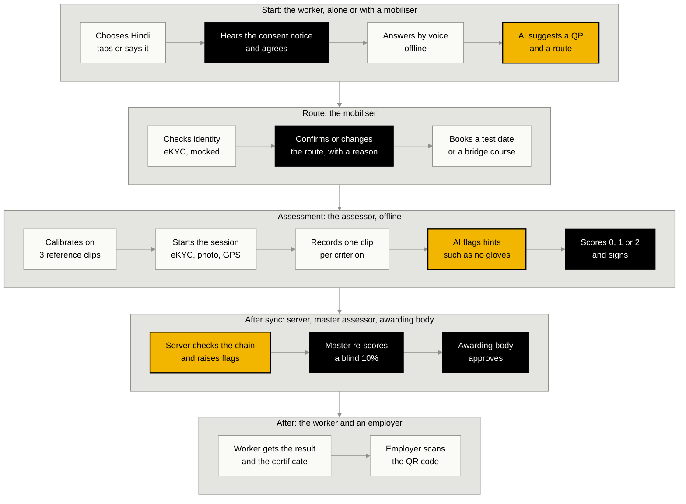
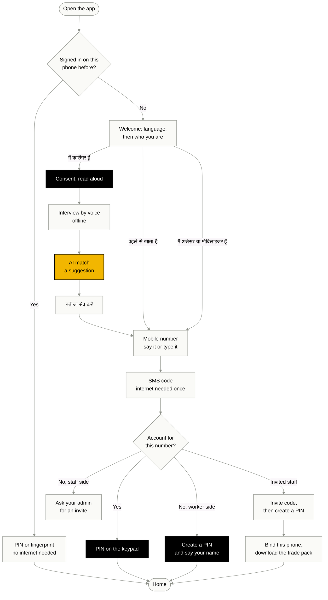
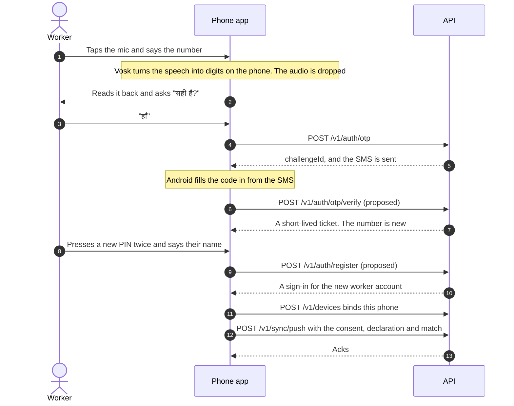
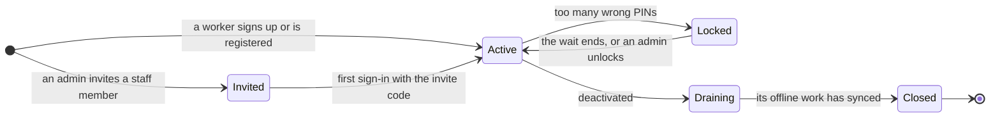
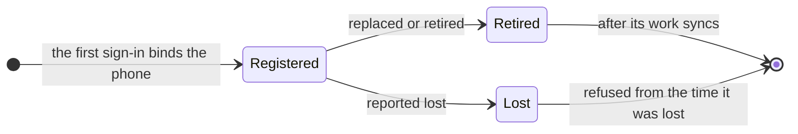

# User workflows: from first use to everyday use

How each person moves through HunarPramaan: how they get an account, how they sign in the first time and every day after, and what every button does. It also adds **sign-up and sign-in by voice in Hindi**, and a list of proposed features.

Read it with [Wire code](wire-code.md), which says how screens look, and [access control](access-control.md), which says who may see and do what. The requirements and the sprint plan are in the [README](../../README.md#requirements-baseline-v1). Where this document and an accepted ADR disagree, the ADR wins.

> [!NOTE]
> Every flow, screen and button carries a status:
>
> - **Built:** in `main` today.
> - **In review:** built on a branch, waiting to be merged.
> - **Planned:** already in the README plan or an accepted ADR.
> - **Proposed:** new in this document, for the team to decide. [ADR 012](../adr/012-voice-sign-in.md) covers voice sign-in and workers signing up on their own phone.
>
> Button labels here are proposed copy. The final strings live in each app's Hindi and English dictionaries (rule 7) and follow Wire code: no arrows on buttons, no ALL CAPS, sentence case.

## Contents

1. [People, apps and accounts](#1-people-apps-and-accounts)
2. [The whole journey](#2-the-whole-journey)
3. [Day zero: setting up the system](#3-day-zero-setting-up-the-system)
4. [Signing in: the rules](#4-signing-in-the-rules)
5. [Sign-up and sign-in by voice, in Hindi](#5-sign-up-and-sign-in-by-voice-in-hindi)
6. [Worker app, screen by screen](#6-worker-app-screen-by-screen)
7. [Mobiliser app](#7-mobiliser-app)
8. [Assessor and master assessor app](#8-assessor-and-master-assessor-app)
9. [Website and office web app](#9-website-and-office-web-app)
10. [Returning users: day 2 to year 2](#10-returning-users-day-2-to-year-2)
11. [Offline and sync, as people see it](#11-offline-and-sync-as-people-see-it)
12. [Messages and reminders](#12-messages-and-reminders)
13. [More features](#13-more-features)
14. [Keeping sign-in safe](#14-keeping-sign-in-safe)
15. [Decisions and next steps](#15-decisions-and-next-steps)

## 1. People, apps and accounts

There are two apps. Field roles use one Android app, which works offline. Office roles use the web app. The phone app has a worker side (Hindi first, with audio and pictures) and a staff side. After sign-in, the account's role decides what the app shows, never the button someone tapped on the welcome screen.

| Person | App | How they get an account | How they sign in | Status |
|---|---|---|---|---|
| Worker, helped by a mobiliser | The mobiliser's phone | None needed: the mobiliser registers them | They don't. The mobiliser's account records their consent and answers | Planned (API built) |
| Worker, on their own phone | Phone app, worker side | Signs up by voice, or claims the record a mobiliser made | Mobile number, SMS code and PIN on a new phone; after that, PIN or fingerprint | Proposed |
| Mobiliser | Phone app, staff side | Invited by their training partner's admin | Number, SMS code and PIN, plus an invite code the first time, on a registered phone | Planned |
| Assessor | Phone app, staff side | Invited by their agency's admin | As the mobiliser | Planned |
| Master assessor | Phone app, staff side | Invited by the awarding body's admin | As the mobiliser | Planned |
| Assessment agency, awarding body | Web app | Invited by their organisation's admin | Number, SMS code and PIN in the browser | Sign-in built; invites planned |
| NCVET | Web app | Created by the platform admin | As above; sees totals only | Sign-in built; accounts planned |
| Admins: four roles (ADR 010) | Web admin | The first platform admin by a command-line bootstrap; the others by invite | As above, and the PIN again before each admin action | Planned |
| Employer, or anyone holding a certificate | Public website | None | None | Built |

**Today (Sprint 0):** the API and the web app, with its sign-in, exist. The phone app starts in Sprint 1. Until then the seed (`pnpm db:seed`) stands in for it and pushes a demo pilot through the real sync path.

## 2. The whole journey

Yellow steps are AI or automated, and only suggest. Black steps are decisions a person makes.

## 3. Day zero: setting up the system

Before the first worker, someone has to create the organisations and the first accounts. This is planned in [ADR 010](../adr/010-organisations-admin-roles-access-control.md). For the demo, the seed does all of it in one command.

| Step | Who | What happens | Status |
|---|---|---|---|
| 1 | The operator, at the command line | A bootstrap command creates the first platform admin and records why | Planned |
| 2 | Platform admin | Creates the organisations: CSDCI (awarding body), an assessment agency, a training partner and NCVET | Planned |
| 3 | Platform admin | Invites each organisation's first admin, and NCVET's view-only accounts | Planned |
| 4 | Platform admin, then the awarding-body admin | Uploads the trade pack. A different person at the awarding body releases it | Planned |
| 5 | Training-partner admin | Adds venues with their geofence | Planned |
| 6 | Organisation admins | Invite their staff: mobilisers, assessors, master assessors, agency and awarding-body users | Planned |
| 7 | Awarding-body admin | Accredits each assessor for the QPs they may assess | Planned |
| 8 | Each staff member | Accepts the invite on their phone or in the browser (below) | Planned |
| Demo | `pnpm db:seed` | Loads the pack, eight demo accounts and a pilot of eight workers. PIN `1234`; the SMS code shows on screen | Built |

### Accepting an invite (staff, first time)

1. The admin enters the person's name, mobile number and role. The system shows the admin a **one-time invite code**. In demo mode it is never sent by SMS, because the SMS code is always `123456` there (ADR 010).
2. The admin gives the code to the person, face to face or by phone.
3. The person opens the phone app and taps "मैं असेसर या मोबिलाइज़र हूँ", or opens the website and clicks "Sign in". They enter or say their number and get an SMS code.
4. They enter the SMS code, then the invite code, then create a PIN twice.
5. On a phone, the app binds the phone to the account and downloads the trade pack (about 70 MB, on Wi-Fi by default). In a browser, the dashboard opens.

Proposed details: invite codes are 8 digits rather than letters, so they are easy to say and type. Each works once and expires after 72 hours.

## 4. Signing in: the rules

### 4.1 What lets you in

| Factor | What it proves | Who uses it | Status |
|---|---|---|---|
| A 6-digit code sent by SMS | You hold that number's SIM now | Everyone, on a new phone or browser | Built, mocked: the code is `123456` and shows on screen |
| A PIN of 4 to 6 digits | You know the secret | Everyone | Built |
| A registered phone | The work comes from a phone the server knows | Field roles | Built (binding); checked on every sync |
| A one-time invite code | An admin added you | Staff, at their first sign-in only | Planned |
| Fingerprint or face, through Android | It's you, on your own phone: a quick unlock | Anyone who turns it on after a PIN sign-in | Proposed |
| Your voice | Nothing. Voice is how you talk to the app, not a key ([section 5](#5-sign-up-and-sign-in-by-voice-in-hindi)) | No one | Proposed rule |

### 4.2 Rules

| # | Rule | Status |
|---|---|---|
| 1 | A code has 6 digits, lasts 5 minutes, allows 5 tries and works once | Built |
| 2 | When the code and PIN are checked together, as on the web today, a wrong one gets one message that never says which was wrong: "कोड या PIN सही नहीं है। फिर से कोशिश करें।" / "That code or PIN is not right. Try again." | Built |
| 3 | Asking for a code never reveals whether the number has an account | Built |
| 4 | A sign-in lasts 12 hours (`JWT_TTL_HOURS`). The browser keeps it in an `httpOnly` cookie and never sees the token. The phone keeps it in encrypted storage | Built (web); planned (phone) |
| 5 | Field roles can't use the web app, and office roles can't sync from a phone | Built |
| 6 | A phone belongs to the first account that registers it. Any other account gets "This device is bound to another account" | Built |
| 7 | Request logs never hold a phone number, code, PIN or token | Built |
| 8 | The PIN is never sent by SMS, never shown once typed, and never spoken by the app or by the person | Proposed |
| 9 | Easy PINs are refused: one digit repeated (0000), a straight run up or down (1234, 654321) or a repeated pair (1212). The demo accounts keep `1234` | Proposed |
| 10 | Workers use a 4-digit PIN. Staff and office users use 6 digits | Proposed |
| 11 | "Send the code again" unlocks after 30 seconds. At most 3 codes per number in 15 minutes and 10 a day, plus a limit per IP address | Proposed numbers for ADR 010's limits |
| 12 | After 5 wrong PINs the account locks for 15 minutes, doubling each time up to ADR 010's cap of 1 hour | Proposed numbers |
| 13 | Signing a result, approving, and every admin action ask for the PIN again | Planned (Wire code, ADR 010) |
| 14 | Every sign-in is logged in `auth_events`, and the app shows the last one, for example "Last sign-in: yesterday, this phone" | Planned (log); proposed (display) |
| 15 | A sign-in from a new phone sends an SMS alert to the number | Proposed |

### 4.3 One way in on the phone

New and returning people go through the same steps, so nobody has to know whether they are signing up or signing in. The server says whether a number has an account only **after** the SMS code proves the person holds that number, so rule 3 still holds. Because the code is checked on its own first, each step can say what went wrong: a wrong code before anything about the account is revealed, and a wrong PIN only after the code has proved the number. (Proposed.)

- **Known phone:** the app asks only for the PIN or a fingerprint, and works with no internet.
- **Worker, new number:** the app creates a worker account ([5.5](#55-flow-a-a-new-worker-signs-up)).
- **Worker, a number a mobiliser registered:** the account is linked to that record, so the worker sees their own journey. We call this claiming the record.
- **Staff, invited:** invite code, a new PIN, then the phone is bound.
- **Staff, not invited:** "इस नंबर पर कोई खाता नहीं है। अपने एडमिन से इनवाइट माँगें।" / "There's no account for this number. Ask your admin for an invite."

Today's API (built) takes the code and the PIN together in one call, `POST /v1/auth/login`. The one way in needs a call that checks the code first ([section 15](#15-decisions-and-next-steps)).

### 4.4 Staying signed in on the phone

| Situation | What happens | Status |
|---|---|---|
| First sign-in on a phone | Needs internet once, for the SMS code | Planned |
| Every later opening | PIN or fingerprint, with no internet. The phone checks the PIN with a key held in the Android Keystore, so it can't be guessed on another computer. The key to the SQLCipher database (ADR 003) stays in the Keystore too | Proposed |
| App left in the background for 5 minutes | Locks. The PIN opens it again where it was. A recording in progress is saved first | Proposed |
| The 12-hour sign-in ends while online | The app renews it in the background, with a renewal key tied to this phone | Proposed |
| It ends while offline | Work goes on. The outbox waits and the pending count stays on screen. At the next signal the app renews and syncs | Proposed |
| 30 days with no sync, a PIN reset, a revoked phone or a deactivated account | The renewal key stops working, and the next sign-in needs a fresh SMS code | Proposed |
| 5 wrong PINs on the phone | A 1-minute wait, doubling each time | Proposed |
| 10 wrong PINs on the phone | Unlocking needs a fresh SMS code, so internet. Unsynced work stays on the phone, encrypted. It is never deleted | Proposed |
| Signing out with work not yet synced | Blocked: "3 चीज़ें अभी भेजनी बाकी हैं।" / "3 items aren't synced yet.", with "अभी सिंक करें" / "Sync now" | Proposed |

### 4.5 When something goes wrong

| Problem | Worker | Mobiliser or assessor | Office user | Status |
|---|---|---|---|---|
| Forgot the PIN | "PIN भूल गए?" on the PIN screen: an SMS code, then a new PIN. Other phones are signed out | Their admin gives a one-time reset code, then they set a new PIN | Same as staff | Proposed (worker); planned (staff, ADR 010) |
| The SMS code doesn't arrive | Wait 30 seconds and tap "कोड दोबारा भेजें"; check the signal; "मदद" calls the mobiliser | Same, or call the admin | Same | Proposed |
| New phone | Sign in with number, code and PIN; synced data comes back | Same, and the new phone is bound. The admin retires the old one, whose unsynced work can still sync (draining) | Sign in on the new computer | Planned (ADR 010) |
| Lost or stolen phone | Tell the mobiliser or the helpline, then sign in on a new phone. Anything not yet synced is lost, but stays encrypted | Tell the admin, who marks the phone lost. It is refused from the time it was lost, and the affected sessions are listed for re-assessment | Not applicable | Planned (ADR 010) |
| New mobile number | The mobiliser checks identity and updates it; the new number is confirmed by SMS | The admin updates it; the new number is confirmed by SMS | Same as staff | Proposed (needs a new admin action) |
| Locked after wrong PINs | Wait, or ask the mobiliser | Wait, or the admin unlocks | Same as staff | Planned |
| Account deactivated | Not applicable | Work already recorded can still sync and is flagged; nothing new starts | Can't sign in | Planned |

### 4.6 Sign-in messages

| Situation | हिंदी | English | Status |
|---|---|---|---|
| Wrong code or PIN | कोड या PIN सही नहीं है। फिर से कोशिश करें। | That code or PIN is not right. Try again. | Built (web) |
| Code expired | इस कोड का समय ख़त्म हो गया। नया कोड मँगाएँ। | This code has expired. Ask for a new one. | Built (web) |
| Server unreachable | सर्वर से जुड़ नहीं पा रहे। कनेक्शन जाँचकर फिर कोशिश करें। | The server cannot be reached. Check your connection and try again. | Built (web) |
| Not a mobile number | 10 अंकों का मोबाइल नंबर डालें। | Enter a 10-digit mobile number. | Built (web) |
| Phone-app account on the web | यह खाता फ़ोन ऐप के लिए है। साइन इन के लिए हुनर प्रमाण ऐप इस्तेमाल करें। | This account is for the phone app. Use the HunarPramaan app to sign in. | Built (web) |
| No internet for the code | इंटरनेट नहीं है। आपका काम फ़ोन में सुरक्षित है। इंटरनेट मिलते ही कोड भेजेंगे। | No internet. Your work is safe on the phone. We'll send the code when you're online. | Proposed |
| Locked | बहुत बार गलत PIN डाला गया। 15 मिनट बाद फिर कोशिश करें। | Too many wrong PINs. Try again in 15 minutes. | Proposed |
| Easy PIN | यह PIN आसान है, कोई अंदाज़ा लगा सकता है। दूसरा PIN चुनें। | That PIN is easy to guess. Choose another. | Proposed |
| PINs don't match | दोनों PIN अलग हैं। फिर से बनाएँ। | The two PINs don't match. Make it again. | Proposed |
| No invite | इस नंबर पर कोई खाता नहीं है। अपने एडमिन से इनवाइट माँगें। | There's no account for this number. Ask your admin for an invite. | Proposed |

## 5. Sign-up and sign-in by voice, in Hindi

Many workers find typing a 10-digit number on a small screen hard, and some can't read the screen at all (NFR-06). So every sign-in step on the phone can be done by speaking Hindi, and every step can still be done by tapping. (Proposed: [ADR 012](../adr/012-voice-sign-in.md).)

### 5.1 What voice does, and what it doesn't

**Voice is how you talk to the app. It isn't a key.** You can say your mobile number, the SMS code, your name, and "हाँ" or "नहीं". What lets you in is still the SMS code, your PIN and your registered phone.

1. **Speak or tap, always.** Every voice step has a keypad or a button on the same screen.
2. **Hear it back, then confirm.** The app repeats what it heard and waits for "हाँ".
3. **Only on the phone.** Vosk turns speech into text on the phone, offline. Sign-in audio is never saved or sent anywhere, not even to Bhashini.
4. **The PIN is never spoken.** It's pressed on a keypad. The app never asks for it aloud and never reads it back.
5. **No voiceprints.** We don't record what a voice sounds like, and we don't recognise people by their voice ([5.10](#510-privacy-and-security-of-voice) says why).
6. **Tap to talk.** The mic listens only after a tap, for at most 10 seconds, with the red recording dot and a timer on screen.
7. **Hindi first.** Hindi digits, Hinglish and English all work: "नौ", "nau" and "nine".
8. **Two misses, then the keypad.** If the app mishears twice, it opens the keypad with what it heard so far.

### 5.2 The mic button

| State | How it looks | What the app does |
|---|---|---|
| Ready | Round black button with a mic icon, labelled "टैप करें और बोलें" / "Tap and speak" | Nothing until tapped |
| Listening | The red recording dot, a timer and moving sound bars (Wire code: red is the recording dot) | Plays a short tone and listens for up to 10 seconds; a second tap stops it |
| Working it out | A spinner on the button with "समझ रहे हैं…" / "Working it out…" | Turns the speech into text on the phone |
| Heard you | What it heard, in large type, with "सही है" and "बदलें" | Reads it back aloud |
| Didn't catch it | A red outline with a warning icon and the words "फिर से बोलें" / "Say it again" | Says "कुछ सुनाई नहीं दिया। फिर से बोलें।" |

### 5.3 Words the app understands on sign-in screens

| Say (Hindi) | Also understood | What it does |
|---|---|---|
| शून्य, एक, दो, तीन, चार, पाँच, छह, सात, आठ, नौ | ज़ीरो; shunya, ek, do; zero to nine | A digit |
| दस to निन्यानवे | das, gyarah; ten to ninety-nine | Two digits, for people who say numbers in pairs: "अट्ठानवे" is 98 |
| डबल, ट्रिपल | double, triple | Repeats the next digit: "डबल सात" is 77 |
| हाँ, जी, सही है | haan, ji, yes | Confirms |
| नहीं, गलत | nahin, galat, no | Goes back to change it |
| दोबारा, फिर से | dobara, phir se, repeat | Plays the question again |
| मिटाओ | mitao, delete | Clears the last thing heard |
| पीछे | peechhe, back | Goes back one screen |
| मदद | madad, help | Opens help: call the mobiliser |
| रुको | ruko, stop | Stops listening |

On sign-in screens the app listens only for these words. A short word list makes recognition much more reliable than free speech: Vosk's small models accept a word list, and the Sprint 1 spike confirms this for the Hindi model. Names are the exception ([5.5](#55-flow-a-a-new-worker-signs-up), step 7).

### 5.4 Saying a mobile number

| What the person says | What the app writes |
|---|---|
| "नौ आठ सात छह पाँच, चार तीन दो एक शून्य" | 98765 43210 |
| "nine eight seven six five, four three two one zero" | 98765 43210 |
| "अट्ठानवे छिहत्तर चौवन बत्तीस दस" | 98765 43210 |
| "नौ आठ डबल सात…" | 9877… |
| "ज़ीरो नौ आठ…" or "प्लस नाइन वन…" | Drops the leading 0 or +91 |
| Only 8 digits | Keeps them and says "अभी 8 अंक मिले। बाकी 2 अंक बोलें।" |
| "सौ" or "हज़ार" | Says "एक-एक अंक बोलें, जैसे नौ, आठ, सात।" |

The number must have 10 digits and start with 6, 7, 8 or 9 (the `Phone` schema). The app reads it back in two groups of five, one digit at a time: "नौ आठ सात छह पाँच, चार तीन दो एक शून्य। सही है?" The read-back uses recorded digit sounds, so it works on phones without a Hindi text-to-speech voice.

### 5.5 Flow A: a new worker signs up

This starts when a worker on their own phone taps "नतीजा सेव करें" after their first interview ([W5](#w5-match-result)). It needs internet once, at step 3.

| # | The app says | In English | The worker | On screen | If it goes wrong |
|---|---|---|---|---|---|
| 1 | "अपना मोबाइल नंबर बोलें। एक-एक अंक बोलें, या नीचे टाइप करें।" | "Say your mobile number, one digit at a time, or type it below." | Taps the mic and says the number | Digits appear as they are heard. "टैप करें और बोलें", "मिटाएँ", "आगे बढ़ें", and a number field with a keypad | Too few digits: asks for the rest. Not a mobile number: "यह मोबाइल नंबर नहीं लगता। फिर से बोलें।" |
| 2 | "आपने बोला: नौ आठ सात छह पाँच, चार तीन दो एक शून्य। सही है?" | "You said: 98765 43210. Is that right?" | Says "हाँ" or taps "सही है" | The number in large type, with "सही है" and "बदलें" | "नहीं" or "बदलें" goes back to step 1 with the digits kept |
| 3 | "आपके नंबर पर 6 अंकों का कोड भेजा है। कोड अपने-आप भर जाएगा।" | "We've sent a 6-digit code to your number. It will fill in by itself." | Waits | Six boxes and a 30-second countdown, then "कोड दोबारा भेजें"; "दूसरा नंबर डालें". In the demo: "डेमो कोड: 123456" | No internet: "इंटरनेट नहीं है। आपका नतीजा फ़ोन में सुरक्षित है। इंटरनेट मिलते ही आगे बढ़ेंगे।" No code after 30 seconds: the mic offers to hear the code |
| 4 | The server checks the code; the number is new | — | — | — | Wrong code: "कोड सही नहीं है। फिर से बोलें या टाइप करें।" (5 tries). The number already has an account: [Flow B](#56-flow-b-a-returning-worker-signs-in) |
| 5 | "अब अपना 4 अंकों का PIN बनाएँ। PIN बोलें नहीं, सिर्फ़ दबाएँ। ध्यान रखें, कोई और न देखे।" | "Now make your 4-digit PIN. Don't say it, just press it. Make sure nobody else is watching." | Presses 4 digits | A big keypad with "मिटाएँ" and 4 dots. Each press clicks and vibrates | An easy PIN: "यह PIN आसान है, कोई अंदाज़ा लगा सकता है। दूसरा PIN चुनें।" |
| 6 | "वही PIN फिर से दबाएँ।" | "Press the same PIN again." | Presses it again | The keypad | Different: "दोनों PIN अलग हैं। फिर से बनाएँ।" |
| 7 | "अपना पूरा नाम बोलें।" | "Say your full name." | Says "रमेश कुमार" | The name in large Devanagari, with "सही है" and "बदलें" (typing). A line: "सर्टिफ़िकेट पर नाम आपकी पहचान जाँच (eKYC) से आएगा।" | Names are free speech, so mistakes are likely. The worker, or someone nearby, fixes it by typing, or the mobiliser does later |
| 8 | "आपका खाता बन गया, रमेश जी। अगली बार बस अपना PIN दबाएँ।" | "Your account is ready, Ramesh ji. Next time, just press your PIN." | — | A green tick with the words "खाता बन गया" | If the phone has no Hindi voice for names, the app leaves the name out |
| 9 | "क्या अगली बार उँगली लगाकर खोलना चाहेंगे?" | "Would you like to open the app with your fingerprint next time?" | Says "हाँ" or taps "अभी नहीं" | Two buttons: "उँगली से खोलें" and "अभी नहीं" | Asked only if the phone has a fingerprint set up |
| 10 | "आपका नतीजा भेज दिया गया। मोबिलाइज़र जल्दी आपसे बात करेंगे।" | "Your result has been sent. A mobiliser will talk to you soon." | — | Home ([W6](#w6-worker-home)) | No internet: it is sent at the next signal |

### 5.6 Flow B: a returning worker signs in

**On the same phone**, with or without internet:

| # | The app says | In English | The worker | On screen |
|---|---|---|---|---|
| 1 | "नमस्ते, रमेश जी! अपना PIN दबाएँ।" | "Hello Ramesh ji! Press your PIN." | Presses the PIN, or touches the fingerprint sensor | The keypad, "उँगली से खोलें" and "PIN भूल गए?" |
| 2 | Says what changed, for example "आपके टेस्ट की तारीख़ तय हो गई है।" | "Your test date is set." | — | Home, with what's new since last time |

A wrong PIN gets "PIN सही नहीं है। 4 कोशिशें बाकी हैं।" / "That PIN is not right. 4 tries left.", and the limits in [4.4](#44-staying-signed-in-on-the-phone) apply.

**On a new phone:** "पहले से खाता है? साइन इन करें" on the welcome screen, then steps 1 to 4 of Flow A, then "अपना PIN दबाएँ।", then home. Everything that synced from the old phone comes back.

**Forgot the PIN:** "PIN भूल गए?" sends an SMS code (internet needed). The worker makes a new PIN twice and hears "आपका PIN बदल गया। बाकी फ़ोनों से साइन आउट कर दिया गया है।" An SMS alert goes to the number ([section 12](#12-messages-and-reminders)).

### 5.7 Flow C: a mobiliser registers a worker by voice

The mobiliser is signed in on their own phone and taps "कारीगर जोड़ें" ([M3](#m3-register-a-worker)). Voice fills the form. Everything works offline.

| Field | By voice | Then |
|---|---|---|
| Name | The mobiliser or the worker says it | Shown in Devanagari, with a Latin spelling for the certificate preview; "सही है" or "बदलें" |
| Mobile number | As in [5.4](#54-saying-a-mobile-number) | Read back; "सही है" |
| Language | "हिंदी" or "English" | Sets the language for the worker's audio and messages |
| 18 or older | "हाँ" or "नहीं" | Under 18, registration stops (ADR 011) |
| Identity check | None | "eKYC करें" (mocked). Only the eKYC reference is kept, never the Aadhaar number (rule 8) |
| Consent | The app reads the notice to the worker | The worker taps or says "हाँ" themselves. The app notes whether it was a tap or voice, never the audio |

"रजिस्टर करें" saves `worker.registered` and `consent.given` to the outbox. If the worker later installs the app on their own phone, Flow B works with the same number, and they see their own journey.

### 5.8 Flow D: staff sign in with voice help

1. The number by voice ([5.4](#54-saying-a-mobile-number)) or by typing.
2. The SMS code fills in by itself, or they say it.
3. The first time only: the 8-digit invite code, by voice or typing.
4. The PIN on the keypad, 6 digits, twice the first time.
5. The first time only: "इस फ़ोन से जोड़ें" / "Use this phone" binds the phone, then the trade pack downloads.

After that: PIN or fingerprint each day. Assessor screens are English first; the spoken prompts follow the app's language. The website has no voice sign-in ([5.10](#510-privacy-and-security-of-voice)).

### 5.9 When voice doesn't work

| Problem | What the app does |
|---|---|
| Too much noise before the person speaks | "यहाँ बहुत शोर है। थोड़ी शांत जगह पर बोलें, या टाइप करें।" and shows the keypad |
| Silence for 5 seconds | "कुछ सुनाई नहीं दिया। फिर से बोलें।" and stops listening |
| Words that aren't numbers | "सिर्फ़ अंक बोलें, जैसे नौ, आठ, सात।" |
| Wrong twice | Opens the keypad with the digits heard so far, ready to fix |
| No microphone permission | Says once why it's needed. "माइक चालू करें" opens the phone's settings, and the keypad works meanwhile |
| The speech model hasn't loaded yet on a slow phone | Shows the keypad first and turns on the mic when ready |
| The worker can't read and voice keeps failing | "मदद" calls the mobiliser, who can register them on the mobiliser's phone ([Flow C](#57-flow-c-a-mobiliser-registers-a-worker-by-voice)) |
| They speak English or Hinglish | Understood, for digits and yes or no |

### 5.10 Privacy and security of voice

- **Sign-in audio never leaves memory.** It is turned into text on the phone and dropped. It is never written to storage, logged or uploaded. Only the digits or the name go on, exactly as if they had been typed.
- **Interview audio is different.** It follows the consent notice and the retention rules. Only the transcript and the audio's hash (`audioSha256`) go with the declaration.
- **The PIN is never spoken**, because people nearby could hear it and a recording could keep it.
- **The SMS code may be spoken** as a last resort. It works once, for 5 minutes, and is useless without the PIN.
- **No voiceprints.** We rejected recognising people by voice (speaker verification) as a way in:
  - a recording or a cloned voice can fool it, and a phone can't reliably check offline that a live person is speaking;
  - work-site noise, a cold or a shared phone would wrongly reject the very people we serve, and lock them out;
  - a voiceprint is biometric data: once leaked it can't be changed like a PIN, and it needs extra care under the DPDP Act;
  - Android gives apps a secure check for fingerprint and face (BiometricPrompt), but none for voice.
- **No voice sign-in on the website.** Browser speech recognition usually sends audio to a cloud service, and rule 8 lets only transcripts leave our servers. If browsers offer recognition that provably stays on the computer, we can look again.

### 5.11 How we'll know it works

Targets for the Sprint 2 and Sprint 3 usability tests. They are what we will measure, not results.

| Measure | Target |
|---|---|
| Mobile numbers heard right within two tries, in a quiet room | 95% |
| The same, at a work site with background noise | 85% |
| Time to sign up by voice, after the interview | Under 3 minutes |
| People who give up on voice and use the keypad | Under 20% |
| Sign-in audio files found on the phone afterwards | None |
| SUS score for the worker flow | 68 or more (NFR-06) |

## 6. Worker app, screen by screen

Worker screens are Hindi first, with audio and pictures, and buttons at least 54px tall (Wire code). Every screen has a speaker button to hear it, and a long press on any button reads its label (proposed). In the tables, "Offline" says whether the button works with no network.

### W1. Welcome

[Reference screen](screens/landing.html). Shown on the first launch, and after signing out. It plays once: "नमस्ते! हुनर प्रमाण में आपका स्वागत है। अपनी भाषा चुनें।" The line "इंटरनेट न हो, तब भी सब फ़ोन में सेव रहता है" sits at the bottom.

| हिंदी | English | What it does | Offline | Status |
|---|---|---|---|---|
| हिंदी | Hindi | Sets the app to Hindi | Yes | Planned |
| English | English | Sets the app to English | Yes | Planned |
| मैं कारीगर हूँ | I'm a worker | Starts the worker side: consent, then the interview | Yes | Planned |
| सुनें (on each card) | Listen | Reads that card aloud | Yes | Planned |
| मैं असेसर या मोबिलाइज़र हूँ | I'm an assessor or mobiliser | Opens staff sign-in ([Flow D](#58-flow-d-staff-sign-in-with-voice-help)) | Internet needed once | Planned |
| पहले से खाता है? साइन इन करें | Already have an account? Sign in | Worker sign-in on a new phone ([Flow B](#56-flow-b-a-returning-worker-signs-in)) | Internet needed once | Proposed |
| टैप करें और बोलें | Tap and speak | Listens for "हिंदी", "English", "कारीगर", "असेसर" or "मोबिलाइज़र" | Yes | Proposed |

### W2. Consent

Shown before anything is recorded, and again whenever the notice changes. The notice plays aloud by itself in the chosen language (NFR-05), with the text on screen.

| हिंदी | English | What it does | Offline | Status |
|---|---|---|---|---|
| फिर से सुनें | Listen again | Plays the notice again | Yes | Planned |
| रोकें, चलाएँ | Pause, play | Pauses or resumes the audio | Yes | Planned |
| पूरी जानकारी पढ़ें | Read the full notice | What we collect, why, for how long, who sees it, and how to withdraw | Yes | Planned |
| हाँ, मैं सहमत हूँ | Yes, I agree | Records consent (`consent.given`, read aloud) and opens the interview | Yes | Planned |
| नहीं | No | Records nothing and goes back, saying "कोई बात नहीं। आप कभी भी लौट सकते हैं।" | Yes | Planned |

The worker gives consent themselves; a mobiliser never agrees for them. Saying "हाँ" counts, and the app notes that consent was given by voice, without keeping the audio.

### W3. Sign-up and sign-in

The flows are in [section 5](#5-sign-up-and-sign-in-by-voice-in-hindi). These are the buttons on those screens.

| हिंदी | English | What it does | Offline | Status |
|---|---|---|---|---|
| टैप करें और बोलें | Tap and speak | Listens ([5.2](#52-the-mic-button)) | Yes | Proposed |
| मिटाएँ | Clear | Removes the last digit; a long press clears them all | Yes | Proposed |
| आगे बढ़ें | Continue | Goes to the next step | Yes | Proposed |
| सही है | That's right | Confirms what was read back | Yes | Proposed |
| बदलें | Change | Opens the keypad or keyboard to fix it | Yes | Proposed |
| कोड दोबारा भेजें | Send the code again | Unlocks after 30 seconds, within the limits in [4.2](#42-rules) | Internet needed | Proposed |
| दूसरा नंबर डालें | Use another number | Goes back to the number | Yes | Proposed |
| PIN भूल गए? | Forgot your PIN? | An SMS code, then a new PIN | Internet needed | Proposed |
| उँगली से खोलें | Unlock with fingerprint | Shows Android's fingerprint prompt | Yes | Proposed |
| अभी नहीं | Not now | Skips the fingerprint offer; it stays in settings | Yes | Proposed |

### W4. Apna Anubhav interview

[Reference screen](screens/interview.html). Planned for Sprint 1 (FR-01, FR-02). The header shows "अपना अनुभव" and the progress, for example "सवाल 3 / 6". Each question plays by itself. The app asks about one NOS at a time, and follow-up questions go only to NOS that aren't covered yet.

| हिंदी | English | What it does | Offline | Status |
|---|---|---|---|---|
| पीछे जाएँ | Back | Goes to the previous question; answers are kept | Yes | Planned |
| सवाल फिर से सुनें | Listen to the question again | Replays the question | Yes | Planned |
| A picture card, for example "अर्थ पिट बनाना" | For example "Making an earth pit" | Marks that task as done, with a black border; a second tap undoes it | Yes | Planned |
| यह नहीं किया | I haven't done this | Marks the NOS as not done and moves on | Yes | Planned |
| टैप करें और बोलें | Tap and speak | Records the answer, with the red dot and a timer, for up to 60 seconds; a second tap stops it | Yes | Planned |
| सही है | That's right | Confirms the transcript shown under "आपने कहा" | Yes | Planned |
| बदलें | Change | Speak again or type. Corrections are logged, to measure speech quality | Yes | Planned |
| बाद में पूरा करें | Finish later | Saves and closes; next time the app opens on the same question | Yes | Proposed |

Behind the screen, Vosk transcribes on the phone and the worker confirms. At the end, the phone saves the declaration and its keyword match (`declaration.recorded`, then `mapping.suggested` by the device mapper). Closing the app mid-answer loses nothing already confirmed (E2E-04).

### W5. Match result

[Reference screen](screens/match-result.html). Planned for Sprint 1 (FR-03, FR-04). A yellow AI hint says "यह AI का सुझाव है। मोबिलाइज़र जाँचकर पक्का करेंगे।" Each QP shows its title, level and coverage with the 70% tick, a route chip ("सीधा टेस्ट दे सकते हैं" or "पहले ब्रिज कोर्स"), a count such as "19 में से 15 काम मिले", and the bridge topics.

| हिंदी | English | What it does | Offline | Status |
|---|---|---|---|---|
| पीछे जाएँ | Back | Back to the last question | Yes | Planned |
| पूरा नतीजा सुनें | Listen to the whole result | Reads the result aloud | Yes | Planned |
| टेस्ट की तारीख़ चुनें | Choose a test date | Shows open slots. The choice stays a request until the mobiliser confirms the route | Slots need a sync | Planned (button); proposed (slots) |
| मोबिलाइज़र से बात करें | Talk to the mobiliser | Calls the mobiliser | Phone network | Planned |
| नतीजा सेव करें | Save my result | Only for a worker on their own phone without an account: starts sign-up ([Flow A](#55-flow-a-a-new-worker-signs-up)) | Internet needed once | Proposed |

This screen shows a suggestion. The route stands only once the mobiliser decides it (rule 1).

### W6. Worker home

[Reference screen](screens/worker-home.html). Shows "नमस्ते, रमेश जी", the journey bar (बताया, मिलान, टेस्ट, सर्टिफ़िकेट: green done, black current, dashed not yet), the next step, the match summary, and a small line for sync and the last sign-in (proposed).

| हिंदी | English | What it does | Offline | Status |
|---|---|---|---|---|
| यह स्क्रीन सुनें | Listen to this screen | Reads the whole screen aloud | Yes | Planned |
| रास्ता देखें | Get directions | Opens the map app at the venue; offline, shows the address | The map needs internet | Planned |
| कॉल करें | Call | Calls the mobiliser or the venue | Phone network | Planned |
| पूरा नतीजा देखें | See the full result | Opens the match result ([W5](#w5-match-result)) | Yes | Planned |
| होम | Home | This screen | Yes | Planned |
| मेरा हुनर | My skills | Result, certificate, profile and settings ([W9](#w9-my-skills-result-and-certificate)) | Yes | Planned |
| मदद | Help | [W10](#w10-help) | Yes | Planned |

The next-step card changes with the journey:

| Stage | Card (हिंदी) | Card (English) |
|---|---|---|
| Waiting for the mobiliser | मोबिलाइज़र आपका मिलान जाँच रहे हैं। | The mobiliser is checking your match. |
| Route confirmed | रास्ता पक्का हुआ: सीधा टेस्ट। तारीख़ जल्दी तय होगी। | Route confirmed: direct test. The date will be set soon. |
| Route changed | मोबिलाइज़र ने रास्ता बदला: पहले ब्रिज कोर्स। कारण: … | The mobiliser changed the route: bridge course first. Reason: … |
| Test booked | टेस्ट: मंगलवार, 24 नवंबर। सुबह 10 बजे, ITI इंदौर। साथ लाएँ: आधार कार्ड, सुरक्षा दस्ताने। | Test: Tuesday 24 November, 10 am, ITI Indore. Bring your Aadhaar card and safety gloves. |
| Test done | टेस्ट हो गया। नतीजा जाँच में है। | Test done. The result is being checked. |
| Approved, pass | बधाई! आपका सर्टिफ़िकेट तैयार है। | Congratulations! Your certificate is ready. |
| Approved, not yet | नतीजा: अभी नहीं। देखें किस काम का और अभ्यास करना है। | Result: not yet. See what to practise. |
| Returned to the assessor | आपके टेस्ट की दोबारा जाँच हो रही है। मोबिलाइज़र आपको बताएँगे। | Your test is being checked again. The mobiliser will tell you. |

The worker sees a result only after the awarding body decides, never straight after the assessor signs, because the awarding body can still return it (proposed).

### W7. Bridge course

Shown when the route is a bridge course first. Proposed.

| हिंदी | English | What it does | Offline | Status |
|---|---|---|---|---|
| ब्रिज कोर्स के विषय | Bridge topics | Lists the gap NOS in simple words, from the match | Yes | Proposed |
| बैच की जानकारी | Batch details | Dates and place, from the training partner | After a sync | Proposed |
| दोबारा मिलान करें | Match me again | After the course: a short interview on the gap topics only, then a new declaration and match. The mobiliser decides again | Yes | Proposed |

### W8. Test day

The worker needs no phone at the test: the assessor's phone does the identity check, the start photo and the clips. The day before, the worker gets a reminder ([section 12](#12-messages-and-reminders)), and home shows what to bring, with pictures.

| हिंदी | English | What it does | Offline | Status |
|---|---|---|---|---|
| साथ ले जाने की लिस्ट सुनें | Listen to what to bring | Reads the checklist aloud | Yes | Proposed |

### W9. My skills: result and certificate

The "मेरा हुनर" tab (FR-17 covers the certificate).

| हिंदी | English | What it does | Offline | Status |
|---|---|---|---|---|
| सर्टिफ़िकेट देखें | View certificate | The certificate with its QR code: the name from the identity check, QP, level, date and code | Yes, once downloaded | Planned |
| QR दिखाएँ | Show QR code | A full-screen QR for an employer to scan; it opens `/verify/<code>` | Yes | Proposed |
| शेयर करें | Share | Sends the verify link by WhatsApp or SMS. The page shows only first name and last initial | Internet needed | Proposed |
| डाउनलोड करें | Download | Saves a PDF on the phone | Internet needed once | Proposed |
| DigiLocker में भेजें | Send to DigiLocker | Mocked in the prototype | Internet needed | Proposed |
| मेरी ताक़त और अभ्यास | My strengths and what to practise | NOS by NOS, in simple words, from the approved profile | Yes | Proposed |
| नतीजे पर सवाल है? | Question about the result? | Asks for a review within 15 days. A person at the agency answers | Internet needed | Proposed, after the pilot |
| सेटिंग | Settings | [W11](#w11-settings-and-privacy) | Yes | Proposed |

### W10. Help

The "मदद" tab. Proposed.

| हिंदी | English | What it does | Offline | Status |
|---|---|---|---|---|
| मोबिलाइज़र को कॉल करें | Call my mobiliser | Calls them | Phone network | Proposed |
| हेल्पलाइन को कॉल करें | Call the helpline | Calls the helpline | Phone network | Proposed |
| आम सवाल सुनें | Listen to common questions | Short recorded answers: what to bring, how long the test takes, how to share a certificate | Yes | Proposed |
| फ़ोन खो गया? | Lost your phone? | What to do ([4.5](#45-when-something-goes-wrong)) | Yes | Proposed |
| दिक्कत बताएँ | Report a problem | Pick a picture: the app, the test or the certificate. The mobiliser gets it at the next sync. No audio | Sent later | Proposed |

### W11. Settings and privacy

Opened from "मेरा हुनर". Proposed.

| हिंदी | English | What it does | Offline | Status |
|---|---|---|---|---|
| भाषा बदलें | Change language | Hindi or English | Yes | Proposed |
| आवाज़ से मदद | Voice help | Turns spoken prompts and the mic on or off | Yes | Proposed |
| बड़े अक्षर | Larger text | Bigger text everywhere | Yes | Proposed |
| उँगली से खोलें | Fingerprint unlock | On or off | Yes | Proposed |
| PIN बदलें | Change PIN | The old PIN, then the new one twice | Internet needed | Proposed |
| मेरा डेटा देखें | See my data | What the app and the server hold about me | The server part needs internet | Proposed |
| सहमति वापस लें | Withdraw consent | As easy as giving it: one screen, read aloud, confirmed with the PIN. Stops further use of the data (`consent.withdrawn`) | Sent at the next sync | Proposed |
| खाता बंद करें | Close my account | Erases personal data as ADR 011 allows; issued certificates are an open question ([15](#15-decisions-and-next-steps)) | Internet needed | Proposed |
| साइन आउट करें | Sign out | Blocked while anything is unsynced ([4.4](#44-staying-signed-in-on-the-phone)) | Yes | Proposed |

## 7. Mobiliser app

Mobiliser screens are Hindi first, because the mobiliser works beside the worker, and they can switch to English (proposed: Wire code names only worker and assessor screens).

### M1. First sign-in and phone setup

[Flow D](#58-flow-d-staff-sign-in-with-voice-help), then:

| हिंदी | English | What it does | Offline | Status |
|---|---|---|---|---|
| इस फ़ोन से जोड़ें | Use this phone | Binds the phone to the account (`POST /v1/devices`) | Internet needed | Built (API) |
| Wi-Fi पर डाउनलोड करें | Download on Wi-Fi | The trade pack, about 70 MB: criteria, glossary, keyword pack and the Hindi speech model | Internet needed | Planned |
| अभी मोबाइल डेटा से | Use mobile data now | Downloads now instead of waiting for Wi-Fi | Internet needed | Planned |

### M2. Home

| हिंदी | English | What it does | Offline | Status |
|---|---|---|---|---|
| अभी सिंक करें | Sync now | Pushes the outbox and pulls updates ([section 11](#11-offline-and-sync-as-people-see-it)) | Internet needed | Planned |
| कारीगर जोड़ें | Register a worker | [M3](#m3-register-a-worker). The primary button | Yes | Planned |
| जाँच के लिए | To review | The review queue, with a count ([M6](#m6-review-queue)) | Yes | Proposed |
| नाम बोलकर ढूँढें | Find by name | Voice search in the worker list, on the phone | Yes | Proposed |
| A worker's row | — | Worker detail ([M7](#m7-worker-detail)) | Yes | Planned |
| मेनू | Menu | Profile, settings, help and sign out | Yes | Planned |

### M3. Register a worker

[Flow C](#57-flow-c-a-mobiliser-registers-a-worker-by-voice) gives the fields. The buttons:

| हिंदी | English | What it does | Offline | Status |
|---|---|---|---|---|
| टैप करें और बोलें | Tap and speak | Fills the field by voice | Yes | Proposed |
| eKYC करें | Run eKYC | Mocked: returns and keeps only a reference | Yes (mock) | Planned |
| कारीगर को फ़ोन दें | Hand the phone to the worker | Switches to the worker's consent screen ([W2](#w2-consent)): big type and audio | Yes | Proposed |
| रजिस्टर करें | Register | Saves `worker.registered` and `consent.given` | Yes | Planned |
| इंटरव्यू शुरू करें | Start the interview | [W4](#w4-apna-anubhav-interview) on this phone, with the worker speaking | Yes | Planned |

### M4. Interview with the worker

The same screens as [W4](#w4-apna-anubhav-interview) and [W5](#w5-match-result), on the mobiliser's phone. The mobiliser may help, but the worker confirms their own transcript.

### M5. Review the match and decide the route

FR-04. The AI's suggestion is a yellow hint beside the mobiliser's decision in black (Wire code).

| हिंदी | English | What it does | Offline | Status |
|---|---|---|---|---|
| सुझाव मानें: सीधा टेस्ट | Accept the suggestion: direct test | Saves `route.decided`, the same as the suggestion | Yes | Planned |
| रास्ता बदलें | Change route | Choose the QP (Level 3 or 4) and the route. A reason is required, 3 to 500 characters, and can be dictated on the phone | Yes | Planned |
| बदलाव सेव करें | Save the change | Saves `route.decided` with the reason | Yes | Planned |
| ऑनलाइन बदलें | Change online | A later change, made when online (`POST /v1/declarations/:id/override`) | Internet needed | Built (API) |

When the coverage is near the 70% line (`needsReview`), there's no default: the mobiliser must choose a route on purpose, and a yellow chip says "लाइन के पास है: ध्यान से जाँचें" (proposed). Every decision shows on the office Declarations page (in review).

### M6. Review queue

"जाँच के लिए" collects what needs the mobiliser. Proposed.

- Matches near the 70% line (`needsReview`).
- Workers whose full server match disagrees with the phone's provisional one (README "AI workflow").
- Workers who signed up on their own phone and need an identity check.
- Interviews that were started but not finished.

Each item has "कॉल करें" / "Call", "पहचान जाँचें" / "Check identity" (eKYC), "पुष्टि करें" / "Confirm" and "रास्ता तय करें" / "Decide the route".

### M7. Worker detail

| हिंदी | English | What it does | Offline | Status |
|---|---|---|---|---|
| टाइमलाइन | Timeline | Registered, consent, declaration, match, decision, test and result, with dates | Yes | Planned |
| कॉल करें | Call | Calls the worker | Phone network | Planned |
| टेस्ट की तारीख़ तय करें | Book a test date | Venue, date and slot. The worker gets an SMS (mocked) | Booking yes; the SMS after a sync | Proposed |
| ब्रिज बैच में जोड़ें | Add to a bridge batch | Puts the worker in a training partner's batch | Yes | Proposed |
| SMS दोबारा भेजें | Send the SMS again | Re-sends the last message | Internet needed | Proposed |
| सहमति वापस लेने में मदद | Help withdraw consent | The same as [W11](#w11-settings-and-privacy), done with the worker present | Sent at the next sync | Proposed |

## 8. Assessor and master assessor app

Assessor screens are English first (Wire code), with every string also in Hindi.

### A1. First sign-in and phone setup

[Flow D](#58-flow-d-staff-sign-in-with-voice-help), then "Use this phone" and the trade-pack download, as in [M1](#m1-first-sign-in-and-phone-setup). For assessors the pack also holds the calibration clips and the safety-gear model. The app shows the QPs the assessor is accredited for (planned).

### A2. Home

Wire code calls this "Assessor home" (to build).

| English | हिंदी | What it does | Offline | Status |
|---|---|---|---|---|
| Sync now | अभी सिंक करें | Pushes and pulls. The pending count is always on screen (FR-10) | Internet needed | Planned |
| Calibrate | कैलिब्रेट करें | [A3](#a3-calibration); shows "Due" or "Done today" | Yes | Planned |
| Start session | सेशन शुरू करें | On each of today's sessions; [A4](#a4-start-a-session) | Yes | Planned |
| Check phone | फ़ोन जाँचें | Storage, battery, GPS and camera, before the day starts | Yes | Proposed |
| Re-score queue | दोबारा जाँच की सूची | Master assessors only; [A9](#a9-blind-re-scoring-master-assessor) | Yes, from the last sync; saving needs internet | Planned |
| Menu | मेनू | Profile, settings (language, upload on Wi-Fi only, fingerprint unlock), help and sign out | Yes | Planned |

### A3. Calibration

FR-07: before scoring, the assessor scores 3 reference clips and sees where they differ from the master scores.

| English | हिंदी | What it does | Offline | Status |
|---|---|---|---|---|
| Play clip | क्लिप चलाएँ | Plays a reference clip | Yes | Planned |
| 0 Can't do it, 1 Partly, 2 Correct, safe | 0 नहीं कर पाते, 1 आधा सही, 2 सही और सुरक्षित | Chooses a score | Yes | Planned |
| Save score | नंबर सेव करें | Saves `calibration.scored` | Yes | Planned |
| See how you compare | तुलना देखें | After 3 clips: your score beside the master's, criterion by criterion, with the rubric line | Yes | Planned |
| Done | हो गया | Back to home | Yes | Planned |

Proposed: calibration is due before the first session of each day.

### A4. Start a session

FR-05.

| English | हिंदी | What it does | Offline | Status |
|---|---|---|---|---|
| Find worker | कारीगर ढूँढें | From today's list, or by name or number | Yes | Planned |
| Run eKYC | eKYC करें | Mocked; keeps only the reference | Yes (mock) | Planned |
| Take start photo | शुरुआती फ़ोटो लें | Takes the photo and hashes it at capture | Yes | Planned |
| Check location | जगह जाँचें | Compares GPS with the venue's geofence: "Inside the venue" (green) or "Outside the venue" (red, flagged) | Yes | Planned |
| Start assessment | असेसमेंट शुरू करें | Saves `session.started` | Yes | Planned |

### A5. Task kit and evidence

FR-06. Wire code calls this "Evidence capture" (to build).

| English | हिंदी | What it does | Offline | Status |
|---|---|---|---|---|
| Steps to watch | देखने वाले कदम | The checklist for this criterion, from the task kit | Yes | Planned |
| Record | रिकॉर्ड करें | The red dot and a timer; 30 to 60 seconds at 480p, with a framing guide | Yes | Planned |
| Stop | रोकें | Stops recording | Yes | Planned |
| Use this clip | यह क्लिप रखें | Hashes the clip (SHA-256) with time, GPS and device, and saves `evidence.captured` | Yes | Planned |
| Re-record | दोबारा रिकॉर्ड करें | Discards the take before it's kept. A clip recorded after that is a new event | Yes | Planned |
| Skip for now | अभी छोड़ें | Comes back later. Signing stays blocked until every criterion has a clip | Yes | Planned |

While recording, a live AI hint may appear in yellow, for example "Gloves not seen". It's a hint only.

### A6. Scoring

FR-08. [Reference screen](screens/scoring.html).

| English | हिंदी | What it does | Offline | Status |
|---|---|---|---|---|
| Back | पीछे | Back to the list of criteria | Yes | Planned |
| Play clip | क्लिप चलाएँ | Plays the clip for this criterion | Yes | Planned |
| GPS checked, Hash checked | GPS जाँचा गया, हैश जाँचा गया | Status chips, not buttons | Yes | Planned |
| AI hint, for example "gloves not seen, 82% sure" | AI सुझाव | Yellow, with "A hint only. Your score decides." | Yes | Planned |
| 0 Can't do it, 1 Partly, 2 Correct, safe | 0 नहीं कर पाते, 1 आधा सही, 2 सही और सुरक्षित | The assessor's score, black when chosen; the rubric line for it appears below | Yes | Planned |
| "Your score differs from the AI hint. Say why." | "आपका नंबर AI सुझाव से अलग है। कारण बताएँ।" | Required for full marks despite a raised flag; can be dictated on the phone (proposed) | Yes | Planned |
| Re-record | दोबारा रिकॉर्ड करें | Back to [A5](#a5-task-kit-and-evidence) for this criterion | Yes | Planned |
| Save score | नंबर सेव करें | Saves `score.recorded` | Yes | Planned |
| Change score | नंबर बदलें | Before signing only: a new score that replaces the old one as a new event (rule 4) | Yes | Planned |

### A7. Review and sign

FR-09. Wire code calls this "Review and sign" (to build).

| English | हिंदी | What it does | Offline | Status |
|---|---|---|---|---|
| Result against the pass rule | पास नियम के सामने नतीजा | The total with the pass mark's black line; NOS bars below | Yes | Planned |
| Evidence checks | सबूत की जाँच | Every criterion has a clip, hashed at capture | Yes | Planned |
| Fix | ठीक करें | On each missing item: jumps to that criterion | Yes | Planned |
| Sign result | नतीजे पर साइन करें | Asks for the PIN, then warns "Signing is final. Changes after this need a new assessment." Saves `recommendation.signed`. Only an assessor account can sign (IT-03) | Yes | Planned |

Online signing (`POST /v1/sessions/:id/sign`, built) refuses a result that doesn't match the scores.

### A8. Sync and uploads

| English | हिंदी | What it does | Offline | Status |
|---|---|---|---|---|
| Sync now | अभी सिंक करें | Sends events, then clips | Internet needed | Planned |
| Upload on Wi-Fi only | सिर्फ़ Wi-Fi पर अपलोड | Holds clips until Wi-Fi | Yes | Planned |
| Retry | फिर कोशिश करें | Retries a failed upload | Internet needed | Planned |

Each clip shows "Waiting for upload", "Hash checked" (green) or "Hash mismatch" (red: the file was refused because its bytes don't match the hash taken at capture).

### A9. Blind re-scoring (master assessor)

FR-13. The task shows the clip, the criterion and the rubric. It never shows the original score or the assessor's name, and never the master's own sessions.

| English | हिंदी | What it does | Offline | Status |
|---|---|---|---|---|
| Play clip | क्लिप चलाएँ | Plays the clip | Needs the clip downloaded | Planned |
| 0, 1, 2 | 0, 1, 2 | Chooses the re-score | Yes | Planned |
| Save re-score | दोबारा जाँच सेव करें | `POST /v1/rescoring`. It's a server action, so it needs internet | Internet needed | API built; screen planned |
| Skip | छोड़ें | Next task | Yes | Planned |

## 9. Website and office web app

Office screens are English first, with every string in Hindi too. These are built.

### 9.1 Public website

| Page | Button | What it does | Status |
|---|---|---|---|
| Home (`/`) | Sign in | Opens `/login` | Built |
| Home | हिंदी, English | Switches the language (a cookie) | Built |
| Home | Certificate code, then "Check certificate" | Opens `/verify/<code>` | Built |
| Verify (`/verify/:id`) | Check certificate | Checks another code | Built |
| Verify | Back to home | Back to `/` | Built |

The verify page says "This certificate is valid", with first name and last initial, QP, level, awarding body, date and code; or "No certificate has this code".

### 9.2 Sign-in (`/login`)

| Button | What it does | Status |
|---|---|---|
| Mobile number, then "Send code" | Asks for an SMS code. The demo shows "Demo code: 123456" | Built |
| 6-digit code, PIN, then "Sign in" | Signs in and opens the dashboard | Built |
| Use another number | Back to the number | Built |

The messages are in [4.6](#46-sign-in-messages). There's no voice sign-in on the web ([5.10](#510-privacy-and-security-of-voice)).

### 9.3 Header and navigation

Every office page has the logo (to the dashboard), the role's pages, the user's name and role, the language switch and "Sign out". Built.

| Role | Pages in the navigation |
|---|---|
| Agency | Dashboard, Declarations, Sessions, Flags |
| Awarding body | Dashboard, Approvals, Declarations, Sessions |
| NCVET | Dashboard |

Declarations is in review.

### 9.4 Pages and their buttons

| Page | Who | Buttons and links | What they do | Status |
|---|---|---|---|---|
| Dashboard | All three | Each flag row; "See all flags" | Open the session or the flags page. NCVET sees totals only, with no per-assessor rows | Built |
| Declarations | Agency, awarding body | None: read-only | Each worker's confirmed transcript, the AI suggestion in yellow and the mobiliser's decision in black | In review |
| Sessions | Agency, awarding body | Each session row | Opens the session | Built |
| Session detail | Agency, awarding body | Back; "Check the hash chain"; the certificate link | Re-verifies every stored event; opens `/verify` | Built |
| Flags | Agency | "Review note" with "Mark as reviewed"; "Open session" | Adds a note. A review never clears a flag | Built |
| Approvals | Awarding body | "Approve and issue certificate" (pass) or "Approve result" (not yet); "Return to assessor", which asks "Why are you returning it?"; "Open session" | Approves, issuing the certificate, or returns with a note. Approval is hidden while blockers remain | Built |

### 9.5 Coming to the web

| Change | Who | Status |
|---|---|---|
| The PIN again before approving | Awarding body | Planned (ADR 010) |
| Admin screens: People, Devices, Audit log | Admins | Planned, Sprints 3 and 4 |
| Accepting an invite in the browser | Office staff | Planned |
| "Export to SIDH (mock)" button; the API exists | Awarding body | Proposed |
| Filters on Declarations: near the line, changed by the mobiliser | Agency | Proposed |
| "Last sign-in" under the user's name | Everyone | Proposed |

## 10. Returning users: day 2 to year 2

| When | Worker | Mobiliser or assessor | Office user |
|---|---|---|---|
| Next morning, same phone | PIN or fingerprint; home shows what changed | PIN; sync pulls new tasks and pack updates | Signs in again once 12 hours have passed |
| A week with no signal | Everything stays on the phone; sync waits | Same. The pending count grows, and renewal happens at the next signal | Not applicable |
| 30 days without a sync | A fresh SMS code at the next sign-in | Same | Not applicable |
| A new trade-pack version | Not applicable | Downloaded at sync. Sessions keep the version they started with | Not applicable |
| A new phone | [Flow B](#56-flow-b-a-returning-worker-signs-in); synced data comes back | [Flow D](#58-flow-d-staff-sign-in-with-voice-help); the old phone is retired and drains | A new browser: sign in |
| After the certificate | The certificate and verify link stay. They can start again for Level 4 with a new interview | Not applicable | Not applicable |
| Years later | The verify page still answers for the certificate code | Not applicable | Not applicable |

An account moves through these states (planned, ADR 010):

And a phone through these:

## 11. Offline and sync, as people see it

| Step | Works offline | Needs internet for |
|---|---|---|
| Welcome, consent, interview, provisional match | Yes | Nothing |
| Signing up, or the first sign-in on a phone | No | The SMS code, once |
| Unlocking the app each day | Yes | Nothing |
| The mobiliser's route decision | Yes | Nothing; it syncs later. Changing it later online needs internet |
| Calibration, the session, clips, scores, signing | Yes | Nothing |
| Uploading clips | No | The upload, which resumes; "Upload on Wi-Fi only" is an option |
| Blind re-scoring | No | It's a server action |
| Approvals, flags, the dashboard | No | They're on the web |
| The certificate on the worker's phone | After the first download | The first download |

The sync line looks the same everywhere: colour with an icon and words, never colour alone.

| State | हिंदी | English | Looks |
|---|---|---|---|
| Everything sent | सब सिंक है | All synced | Green, with a tick |
| Waiting | 12 बाकी | 12 waiting | Black, with a clock |
| Failed | भेज नहीं पाए, फिर कोशिश करें | Couldn't send. Try again | Red, with a warning sign |

The airplane-mode drill (E2E-02) runs every worker and assessor step with no network.

## 12. Messages and reminders

Proposed. SMS and voice calls are mocked in the prototype.

| When | To | How | हिंदी | English |
|---|---|---|---|---|
| A sign-in code | Anyone | SMS | हुनर प्रमाण कोड: 123456। यह कोड किसी को न बताएँ। हम कभी कोड नहीं माँगते। | HunarPramaan code: 123456. Don't share it. We never ask for it. |
| Account created | Worker | SMS | हुनर प्रमाण में आपका खाता बन गया। अपना PIN किसी को न बताएँ। | Your HunarPramaan account is ready. Never share your PIN. |
| A sign-in from a new phone | Everyone | SMS | आपके खाते में नए फ़ोन से साइन इन हुआ। आपने नहीं किया? मोबिलाइज़र या हेल्पलाइन को बताएँ। | Your account was opened on a new phone. Wasn't you? Tell your mobiliser or the helpline. |
| PIN changed | Everyone | SMS | आपका PIN बदल गया। आपने नहीं बदला? तुरंत बताएँ। | Your PIN was changed. Wasn't you? Tell us now. |
| Route decided | Worker | In the app and by SMS | आपका रास्ता तय हुआ: सीधा टेस्ट। | Your route is set: direct test. |
| Test booked | Worker | In the app and by SMS | आपका टेस्ट: 24 नवंबर, सुबह 10 बजे, ITI इंदौर। साथ लाएँ: आधार कार्ड, सुरक्षा दस्ताने। | Your test: 24 November, 10 am, ITI Indore. Bring your Aadhaar card and safety gloves. |
| The day before the test | Worker | Voice call and SMS | कल सुबह 10 बजे आपका टेस्ट है। | Your test is tomorrow at 10 am. |
| Result approved | Worker | In the app and by SMS | बधाई! आपका सर्टिफ़िकेट तैयार है। ऐप में "मेरा हुनर" खोलें। | Congratulations! Your certificate is ready. Open "My skills" in the app. |
| A new flag that blocks approval | Agency | On the web; email later | Not applicable | A session has a flag that blocks approval. |

- A message never holds a PIN or an Aadhaar number, and shows a phone number masked, for example `******3210`.
- Messages use the worker's language. Voice calls play recorded prompts.
- The code SMS ends with the app's hash, so Android's SMS Retriever fills the code in without asking for permission to read messages.

## 13. More features

Proposed, for the team to choose. None of them displaces a Must in the README; each would go through the usual PR and requirement process.

| ID | Feature | Helps | Priority | When | Needs |
|---|---|---|---|---|---|
| P-01 | Voice sign-up and sign-in in Hindi ([section 5](#5-sign-up-and-sign-in-by-voice-in-hindi)) | Workers, mobilisers | Should | S3, with device binding and OTP + PIN | ADR 012; the word-list check in the S1 spike |
| P-02 | A speaker button on every worker screen, and a long press to hear any button | Workers | Should | S1 and S2 | Recorded prompts |
| P-03 | Voice commands: हाँ, नहीं, दोबारा, पीछे, आगे, मदद | Workers | Should | S2 | The word list from P-01 |
| P-04 | One way in on the phone ([4.3](#43-one-way-in-on-the-phone)) | Everyone on a phone | Should | S3 | New auth calls ([15.2](#152-api-and-contract-changes)) |
| P-05 | Remember this phone: renewal key and offline unlock ([4.4](#44-staying-signed-in-on-the-phone)) | Everyone on a phone | Should | S3 | `POST /v1/auth/refresh` |
| P-06 | Fingerprint or face unlock | Everyone on a phone | Could | S5 | Android BiometricPrompt |
| P-07 | Workers sign up on their own phone ([Flow A](#55-flow-a-a-new-worker-signs-up)) | Workers | Could | S4 or S5 | ADR 012 and a contract change |
| P-08 | Claim a record a mobiliser made | Workers | Could | S5 | P-04 |
| P-09 | The SMS code fills in by itself | Everyone on a phone | Should | With real SMS, after the pilot | SMS Retriever |
| P-10 | Last sign-in on screen, and an SMS for a new phone | Everyone | Could | S5 | `auth_events` (ADR 010) |
| P-11 | Help tab: call the mobiliser, common questions read aloud, lost phone | Workers | Should | S2 | Recorded answers |
| P-12 | Test-day reminders by SMS and voice call | Workers | Could | S5 | Mocked SMS and calls |
| P-13 | Workers pick a preferred test slot; the mobiliser confirms | Workers, mobilisers | Could | After S4 | Venue slots |
| P-14 | Bridge-course tracker, then a short re-match | Workers, mobilisers | Later | After the pilot | Training-partner batches |
| P-15 | Certificate wallet: QR, PDF, share link, DigiLocker (mock) | Workers, employers | Should | S4, with FR-17 | The verify page (built) |
| P-16 | Strengths and what to practise, in simple Hindi | Workers | Could | S5 | The NOS-wise profile |
| P-17 | Ask for a review of a result | Workers, agency | Later | After the pilot | A new human decision (ADR 006) |
| P-18 | Privacy centre: see my data, withdraw consent, close my account | Workers | Should | S5 | ADR 011 erasure |
| P-19 | Dictating a reason by voice, on the phone | Mobilisers, assessors | Could | S4 | On-device speech |
| P-20 | Voice search for a worker by name | Mobilisers | Could | S5 | On-device speech |
| P-21 | Review queue on the mobiliser's phone ([M6](#m6-review-queue)) | Mobilisers | Should | S1 and S2 | Pull updates |
| P-22 | A phone check before the day: storage, battery, GPS, camera | Assessors | Could | S5 | None |
| P-23 | "Export to SIDH (mock)" button on the web | Awarding body | Could | S4 | The API (built) |
| P-24 | Filters on the Declarations page | Agency | Could | S5 | The read model (in review) |
| P-25 | A missed-call line for workers without a smartphone | Workers | Later | After the pilot | A mocked voice line |
| P-26 | Larger text setting | Everyone on a phone | Could | S5 | None |

## 14. Keeping sign-in safe

| Threat | Example | What stops it | Status |
|---|---|---|---|
| Guessing a code | A script tries every 6-digit code | 5 tries per code, 5-minute expiry, limits per number and per IP address | Built; limits planned |
| Guessing a PIN | Trying common PINs | One message for any wrong code or PIN, lockouts, easy PINs refused | Built; lockout planned; PIN rules proposed |
| SIM swap | Someone gets a new SIM for the number | The SMS code alone never opens an account: the PIN is needed too, field roles need the registered phone, and a new phone triggers an SMS alert | Built; alert proposed |
| Overhearing | Voice sign-in in a crowded place | The PIN is never spoken; a mobile number isn't a secret; the code fills in by itself | Proposed |
| A replayed or cloned voice | A recording of the worker | Voice isn't a key, and there are no voiceprints | Proposed |
| A stolen phone | The app picked up while open | Locks after 5 minutes in the background; the PIN to reopen; encrypted data (SQLCipher); the phone is marked lost | Planned and proposed |
| A shared phone | A family phone | One worker account per phone; assisted mode shows one worker at a time; signing out | Proposed |
| A stolen web token | A script injected into a page | `httpOnly` cookie; the server calls the API; the browser never holds the token | Built |
| A fake SMS or call | "Tell me your code" | Messages say we never ask for codes; mobilisers never ask for a PIN | Proposed |
| An admin abusing their role | Creating a fake assessor | The platform admin can't create accounts that decide; every admin action is logged; two admins per organisation | Planned (ADR 010) |
| A lost phone with unsynced work | Evidence on a missing phone | Encrypted; refused from the time it was lost; affected sessions re-assessed | Planned (ADR 010) |

## 15. Decisions and next steps

### 15.1 Decisions for the team

| # | Question | Recommendation |
|---|---|---|
| 1 | Accept [ADR 012](../adr/012-voice-sign-in.md): voice as an input, not a key, and no voiceprints? | Yes |
| 2 | Do workers sign up on their own phone in the pilot, or only through a mobiliser, with claiming later? | Through a mobiliser for the pilot demo. Own-phone sign-up after G2, if there's time |
| 3 | Which organisation holds a worker who signed up alone, before a mobiliser verifies them? ADR 010 puts workers with the training partner | None until verified, and the verifying mobiliser's training partner after that |
| 4 | PIN length: 4 digits for workers and 6 for staff? | Yes; the demo keeps `1234` |
| 5 | Ship the Vosk Hindi model inside the app, so voice works on first launch offline? | Yes, about 42 MB more in the APK |
| 6 | Show the worker a result only after the awarding body decides? | Yes |
| 7 | Mobiliser screens Hindi first? | Yes, with an English switch |
| 8 | When a worker closes their account, what happens to an issued certificate? | Decide with the data fiduciary. One option: the register keeps the certificate code and QP and drops the name |
| 9 | How long "remember this phone" lasts, and when the app locks itself | 30 days without a sync; 5 minutes in the background |

### 15.2 API and contract changes

All proposed. Rule 9 applies: a version bump and a note in the PR. The contract changes should land before v1 freezes on 25 Oct, with ADR 010's and ADR 011's, or wait for v2.

| Change | Why | Kind |
|---|---|---|
| `POST /v1/auth/otp/verify`: checks a code alone and returns a short-lived ticket and whether the number has an account | One way in ([4.3](#43-one-way-in-on-the-phone)) | New call |
| `POST /v1/auth/register`: creates a worker account from a ticket, a PIN, a name and a language | Workers signing up ([Flow A](#55-flow-a-a-new-worker-signs-up)) | New call |
| `POST /v1/auth/login` also accepts a ticket with the PIN | One way in; the code-and-PIN form stays | Additive |
| `POST /v1/auth/refresh`: renews a sign-in with the phone's renewal key | Remember this phone ([4.4](#44-staying-signed-in-on-the-phone)) | New call |
| `POST /v1/auth/pin`: changes the PIN (old PIN) or resets it (ticket) | Forgot or change PIN | New call |
| `AUTHORITY`: `worker` may perform `worker.registered` and `device.registered` | Workers signing up and binding their own phone | Contract change |
| `consent.given` records whether consent was given by tap or by voice | Proof of how consent was given | Contract change (event payload) |
| An admin action for a changed mobile number | [4.5](#45-when-something-goes-wrong) | Contract change (ADR 010 list) |

### 15.3 Tests to add

| ID | What it proves |
|---|---|
| E2E-05 (proposed) | Voice sign-up on the 3 GB phone, then everything else in airplane mode (Maestro) |
| IT-06 (proposed) | Code and PIN limits, lockouts, and one message for any wrong code or PIN |
| IT-07 (proposed) | A renewal key is refused after the phone is revoked, the account is deactivated or the PIN is reset |
| Unit (proposed) | Spoken numbers to digits: Hindi, Hinglish, English, pairs, "डबल" and "ट्रिपल", a leading 0 or +91 |
| Usability | Voice sign-up in the S2 SUS test with 5 workers, against the targets in [5.11](#511-how-well-know-it-works) |

### 15.4 Where it fits in the sprints

| Sprint | Work from this document |
|---|---|
| S1 | Recorded Hindi prompts and digit sounds; check Vosk's word-list mode with the Hindi model in the spike; welcome, consent, interview and match screens |
| S2 | Speaker buttons and voice commands; the help tab; the mobiliser's review queue |
| S3 | Device binding, OTP + PIN (already planned), plus voice sign-in, one way in and remember this phone |
| S4 | Certificate wallet; dictated reasons; workers signing up on their own phone, if decision 2 says yes |
| S5 | Fingerprint unlock, reminders, privacy centre, last sign-in, declaration filters |
